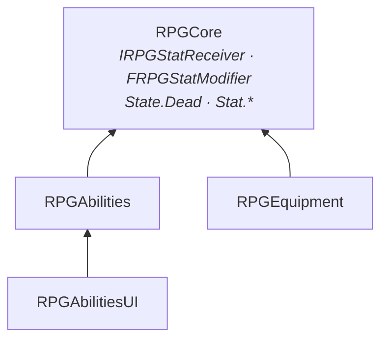
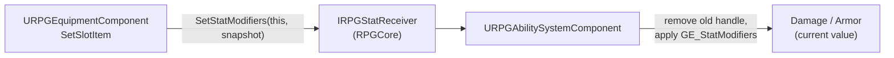
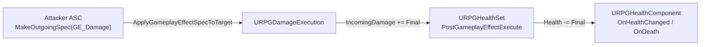

# Abilities & Stats System (GAS)

Health, stamina and combat stats built on Unreal's **Gameplay Ability System**: attribute sets, a damage pipeline
(attacker's Damage vs. target's Armor), equipment bonuses applied as gameplay effects, input-driven abilities with
cost and cooldown, a health component that reports damage and death, and a generic attribute bar for the HUD.

| Question | Owner |
|---|---|
| *What numbers does a character have?* | **Attribute sets** (`URPGHealthSet`, `URPGStaminaSet`, `URPGCombatSet`) |
| *Who owns them and runs abilities?* | **`URPGAbilitySystemComponent`** (on the pawn) |
| *How much damage does a hit do?* | **`URPGDamageExecution`** inside `GE_Damage` |
| *When does a character die?* | **`URPGHealthComponent`** (on the pawn) |
| *How do equipment and progression bonuses reach the stats?* | **`IRPGStatReceiver`** / **`IRPGTagReceiver`** (RPGCore), implemented by the ASC |
| *What can the character do?* | **Abilities** derived from `URPGGameplayAbility` |
| *How does the player see it?* | **`URPGAttributeBarWidget`** (`RPGAbilitiesUI`) |

---

## 1. Modules

```
Plugins/
├── RPGCore/                            IRPGStatReceiver, IRPGTagReceiver, FRPGStatModifier, State.Dead / Stat.* tags
└── RPGAbilities/
    ├── RPGAbilities   (Runtime)        ASC, attribute sets, health component, damage execution, abilities
    └── RPGAbilitiesUI (Runtime)        Attribute bar widget (UMG)
```

| Module | Depends on | Why |
|---|---|---|
| `RPGAbilities` | `RPGCore`, `GameplayAbilities`, `GameplayTags`, `GameplayTasks` | GAS integration; receives stat modifiers through an RPGCore interface |
| `RPGAbilitiesUI` | `RPGAbilities`, `GameplayAbilities`, `UMG` (+ private `Slate`, `SlateCore`) | Displays attributes |

The `.uplugin` lists **`RPGCore`** and **`GameplayAbilities`** as plugin dependencies.

**`RPGAbilities` does not depend on `RPGEquipment`, and `RPGEquipment` does not depend on GAS.** Equipment pushes
its modifiers into whatever implements `IRPGStatReceiver` on the owner; without an ability system component, equipment
still works and simply has no effect on stats.



---

## 2. Attributes

All sets derive from `URPGAttributeSet`, which provides the `RPG_ATTRIBUTE_ACCESSORS` macro
(`GetXAttribute()`, `GetX()`, `SetX()`, `InitX()`).

| Set | Attributes | Rules |
|---|---|---|
| `URPGHealthSet` | `Health`, `MaxHealth`, `IncomingDamage` | `Health` is clamped to `[0, MaxHealth]`; `MaxHealth ≥ 1`; lowering `MaxHealth` lowers `Health`, never heals |
| `URPGStaminaSet` | `Stamina`, `MaxStamina` | Same clamping rules |
| `URPGCombatSet` | `Damage`, `Armor` | Names match the `Stat.Damage` / `Stat.Armor` tags used by equipment |

- Clamping happens in both `PreAttributeBaseChange` (instant and periodic effects) and `PreAttributeChange`
  (infinite and duration effects, e.g. equipment), so no kind of effect can push a value out of range.
- **`IncomingDamage` is a meta attribute.** Damage effects write to it; `PostGameplayEffectExecute` reads it, resets
  it to 0 and subtracts it from `Health`. Armor, shields or damage-to-mana later plug into this one place.
- Starting values come from an instant effect (`GE_InitStats`), not from C++ defaults, so a goblin and a boss can
  share the same sets with different data. `MaxX` is set before `X` so the clamp does not cut the starting value.

---

## 3. `URPGAbilitySystemComponent`

Add it to any pawn like a normal component; `IAbilitySystemInterface` is not required (GAS falls back to a component
search).

| Property | Description |
|---|---|
| `DefaultAttributeSets` | Created in `InitializeComponent`, i.e. **before any component's `BeginPlay`**, so other components can rely on them |
| `DefaultEffects` | Applied on `BeginPlay` (e.g. `GE_InitStats`, `GE_StaminaRegen`) |
| `DefaultAbilities` | Granted on `BeginPlay`; each ability's `InputTag` is copied into its spec |
| `StatModifierEffect` | Infinite effect used for stat bonuses (`GE_StatModifiers`, see section 5) |

| Function | Description |
|---|---|
| `AbilityInputTagPressed(Tag)` | Marks matching abilities as pressed, then tries to activate the inactive ones |
| `AbilityInputTagReleased(Tag)` | Forwards the release (for hold / charge abilities) |
| `SetStatModifiers(Source, Modifiers)` | `IRPGStatReceiver` implementation |
| `SetGrantedTags(Source, Tags)` | `IRPGTagReceiver` implementation: replaces the loose tags held for `Source` (used by skills, e.g. `Skill.Dodge`) |

Empty or duplicate entries in the arrays are skipped with a warning (`LogRPGAbilities`).
`AbilityInputTagPressed` collects handles first and activates afterwards, so an ability that grants other abilities
on activation cannot invalidate the loop.

---

## 4. Health and death: `URPGHealthComponent`

Turns the `Health` attribute into gameplay events. It only reports; reacting to death (ragdoll, respawn, loot) is
the game layer's job.

| Member | Description |
|---|---|
| `OnHealthChanged(Component, Old, New, Instigator)` | Every change: damage, heal, `MaxHealth` clamp. `Instigator` may be null |
| `OnDeath(DeadActor, Killer)` | Fired **once** when `Health` reaches 0 |
| `GetHealth()`, `GetMaxHealth()`, `GetHealthNormalized()`, `IsDead()` | Queries for UI and AI |

On death the component adds the loose tag **`State.Dead`** (RPGCore) to the ASC. Every `URPGGameplayAbility` has
`State.Dead` in its `ActivationBlockedTags`, so dead characters cannot act, and melee attacks skip dead targets.
The instigator comes from the effect context, which is why every effect in this system is created with a filled
context (`MakeEffectContext` / `MakeOutgoingGameplayEffectSpec`).

### The meta-attribute instigator pitfall

GAS attaches "which effect caused this" (`GEModData`) only to the attribute an effect modifies **directly**. Damage
modifies `IncomingDamage`; `Health` is then changed by our own `SetHealth` call in `PostGameplayEffectExecute`, so the
`Health` change callback arrives with `GEModData == nullptr` and no instigator. Without a fix, `OnDeath` reports a
null `Killer` and kill rewards cannot work.

```cpp
// URPGHealthSet::PostGameplayEffectExecute, IncomingDamage branch
DamageInstigator = Data.EffectSpec.GetContext().GetOriginalInstigator();
SetHealth(...);              // the Health callback runs synchronously inside this call
DamageInstigator.Reset();
```

`URPGHealthComponent` uses `GEModData` when it exists (an effect that changes `Health` directly, e.g. a heal) and
otherwise asks the set for `GetDamageInstigator()`. The value is a weak pointer and only lives for that one call, so
later unrelated changes (a `MaxHealth` clamp) are never attributed to an old attacker.

---

## 5. Equipment → stats bridge



1. After every slot change, equipment sends a **snapshot** of all its modifiers (`Stat.Damage +15`, `Stat.Armor +2`),
   then broadcasts `OnEquipmentChanged` (state first, then broadcast).
2. The ASC removes the effect it previously applied for that source, sums the modifiers per stat and applies
   `GE_StatModifiers` with **SetByCaller** magnitudes keyed by the stat tags. Every SetByCaller tag the effect uses is
   first set to 0, so an item that only gives Damage does not produce "SetByCaller not found" errors for Armor.
3. The effect is **Infinite**, so it changes the current value and leaves the base value alone. Unequipping removes
   the effect and the stat returns to its base.

| Design choice | Reason |
|---|---|
| Snapshot instead of deltas | A missed or reordered event can never leave stats wrong; swapping is just "replace" |
| Keyed by `Source` | Equipment, buffs and progression can each own their own stat effect without interfering |
| One SetByCaller effect | Adding a stat = new tag + new attribute + one modifier line in `GE_StatModifiers`; no code |

---

## 6. Damage pipeline



`GE_Damage` is an instant effect with no modifiers and one execution, `URPGDamageExecution`:

```
Final = max(Source.Damage + SetByCaller.Damage - Target.Armor, MinimumDamage)
```

| Input | Captured from | Snapshot |
|---|---|---|
| `Damage` | Source (attacker) | **Yes**, the value when the effect is created (a projectile keeps the power it was fired with) |
| `Armor` | Target | **No**, the value when the effect lands |
| `SetByCaller.Damage` | The ability (optional base damage) | — |

`MinimumDamage` (default 1) guarantees that armor never makes a target immune. The same `GE_Damage` works for every
weapon and every target because the numbers come from attributes, not from the effect.

---

## 7. Abilities

### `URPGGameplayAbility` (base)

| Member | Description |
|---|---|
| `InputTag` | Which input triggers the ability (`InputTag.Attack`, `InputTag.Dodge`). The input layer only knows tags; the same ability works from keyboard, gamepad or AI |
| Instancing | `InstancedPerActor`: one instance per character, reused every activation (per-activation state is reset in `ActivateAbility`) |
| Blocked by | `State.Dead` |

### `URPGMeleeAbility` (C++)

| Property | Description |
|---|---|
| `AttackMontage` | Optional. If set, the hit happens when the montage sends `HitEventTag`; if empty, after `HitDelay` |
| `HitEventTag` | Default `Event.Melee.Hit` (sent by an AnimNotify on the montage) |
| `DamageEffect`, `BaseDamage` | Usually `GE_Damage`; `BaseDamage` is passed as `SetByCaller.Damage` |
| `TraceRange`, `TraceRadius`, `HitObjectTypes` | Sphere sweep in front of the avatar |
| `bDrawDebug` | Draws the sweep |

Flow: `CommitAbility` → wait for the hit event (registered **before** the montage starts) and play the montage, or
wait `HitDelay` → sweep → each actor is damaged **once** (capsule and mesh hits are merged), actors without an ASC and
dead targets are skipped → end when the montage completes or is interrupted.

The native `ActivateAbility` deliberately does **not** call `Super`: the base implementation commits the ability
itself when there is no Blueprint graph, which would apply cost and cooldown twice.

### `GA_Dodge` (Blueprint example)

Launches the character in the movement-input direction (or forward when standing still).

| Setting | Value |
|---|---|
| Cost | `GE_DodgeCost`: instant, `Stamina -25` |
| Cooldown | `GE_DodgeCooldown`: 1 s duration, grants `Cooldown.Dodge` |
| Requires | `Skill.Dodge` (*Activation Required Tags*), granted by the Dodge skill in [Progression](Progression.md) |

GAS checks both before activation: with less than 25 stamina, or while `Cooldown.Dodge` is present, the ability
simply does not start. Blueprint abilities must call **Commit Ability** themselves, and every execution path must end
in **End Ability**, otherwise the ability stays active and can never be triggered again.

### Stamina regeneration

`GE_StaminaRegen` is an infinite effect with a **period** of 0.1 s (`Stamina +2` per tick). Periodic effects modify
the base value each tick, so they pass through the clamp and stop at `MaxStamina`. An optional tag requirement
(`State.Dead`) pauses it while the character is dead.

---

## 8. UI (`RPGAbilitiesUI`)

### `URPGAttributeBarWidget`

One generic bar for any "value / max" pair. Pick the attributes per instance in the designer.

| Member | Description |
|---|---|
| `ValueAttribute`, `MaxAttribute` | e.g. `RPGStaminaSet.Stamina` / `RPGStaminaSet.MaxStamina` |
| `bAutoBindToOwningPawn` | Follows the owning player's pawn, including respawn and possession changes |
| `SetAbilitySystem(ASC)` | Bind manually (e.g. an enemy health bar). `nullptr` empties the bar |
| `Bar` (required), `ValueText` (optional) | `"75 / 100"` |
| `BP_OnValueChanged(Value, Max)` | Designer hook (flash, low-value colour) |

The bar listens to **both** attributes, so a change of the maximum (e.g. from equipment) updates the fill even when
the value itself does not change.

---

## 9. Setup

### Character
1. Add **`RPG Ability System`** to the pawn:
   - `DefaultAttributeSets`: `RPGHealthSet`, `RPGStaminaSet`, `RPGCombatSet`
   - `DefaultEffects`: `GE_InitStats`, `GE_StaminaRegen`
   - `DefaultAbilities`: `GA_MeleeAttack`, `GA_Dodge`
   - `StatModifierEffect`: `GE_StatModifiers`
2. Add **`RPG Health`** and bind `On Death` to your death logic.
3. Input: in the character Blueprint, call `Ability Input Tag Pressed / Released` with `InputTag.Attack` /
   `InputTag.Dodge`.

### Effects

| Asset | Type | Content |
|---|---|---|
| `GE_InitStats` | Instant | Override `MaxHealth`, `Health`, `MaxStamina`, `Stamina`, `Damage`, `Armor` (max before value) |
| `GE_StaminaRegen` | Infinite, Period 0.1 | `Stamina +2` |
| `GE_StatModifiers` | Infinite | Add SetByCaller for `Damage` (`Stat.Damage`), `Armor` (`Stat.Armor`), `MaxHealth` (`Stat.MaxHealth`), `MaxStamina` (`Stat.MaxStamina`) |
| `GE_Damage` | Instant | Execution: `RPGDamageExecution` |
| `GE_DodgeCost` | Instant | `Stamina -25` |
| `GE_DodgeCooldown` | Duration 1 s | Grants `Cooldown.Dodge` |

### HUD
1. `WBP_AttributeBar` from `RPGAttributeBarWidget` (`ProgressBar` named `Bar`, optional `TextBlock` named `ValueText`).
2. `WBP_HUD` with one bar per attribute pair; set `Value Attribute` / `Max Attribute` on each instance.
3. PlayerController `BeginPlay` → `Create Widget (WBP_HUD)` → `Add to Viewport`.

### Debugging
`showdebug abilitysystem` shows attributes (with the effects modifying them), owned tags (`State.Dead`,
`Cooldown.Dodge`) and granted abilities. **PageUp / PageDown** cycles the target actor.

---

## 10. Tags

| Tag | Module | Use |
|---|---|---|
| `State.Dead` | RPGCore | Added on death; blocks abilities, skipped by attacks |
| `Stat.Damage`, `Stat.Armor` | RPGCore | Equipment modifiers and SetByCaller keys |
| `SetByCaller.Damage` | RPGAbilities | Ability base damage |
| `InputTag.Attack`, `InputTag.Dodge` | RPGAbilities | Input → ability routing |
| `Event.Melee.Hit` | RPGAbilities | Montage hit frame |
| `Cooldown.Dodge` | RPGAbilities | Granted by the dodge cooldown effect |
| `Skill.Dodge` | Project settings | Required by `GA_Dodge` (*Activation Required Tags*); granted by the Dodge skill |

---

## 11. Design Decisions

| Decision | Reason |
|---|---|
| ASC on the pawn as a component | Same as inventory and equipment; works for players and AI without a PlayerState |
| Attribute sets created in `InitializeComponent` | Other components' `BeginPlay` (equipment pushing stats) can rely on them regardless of order |
| Starting values from an effect | Data, not code; per-character variants without subclasses |
| Meta attribute for damage | One place converts damage into health loss; future shields / resistances hook in there |
| Separate health component | Attribute sets stay numeric; events and the `State.Dead` tag live in a Blueprint-friendly component |
| Stat bridge through an RPGCore interface | Equipment, Progression and GAS stay independent plugins |
| Instigator exposed by the health set during `SetHealth` | Keeps the meta-attribute design and still reports who dealt the damage |
| Input tags instead of keys | Rebinding, gamepad and AI use the same abilities |
| Cost and cooldown as effects | Checked by GAS before activation; a buff can later shorten a cooldown by changing data |
| Generic attribute bar | Health, stamina and future mana share one widget class |

---

## 12. Known Limitations / Next Steps

- Single-player only: attributes are not replicated and abilities are not predicted.
- Current values (`Health`, `Stamina`) reset on respawn because the ASC lives on the pawn. Level and skill bonuses
  are re-applied by Progression (on the PlayerState); Save / Load will restore the rest.
- No revive: `URPGHealthComponent` does not clear `State.Dead`.
- The melee attack uses a delay until an attack animation is added (the montage path and the `Event.Melee.Hit`
  notify are supported; the notify class is not written yet).
- No hit reactions, damage numbers, gameplay cues (sound / VFX) or enemy health bars yet.
- The clamp logic is duplicated in `URPGHealthSet` and `URPGStaminaSet`; a third "value / max" set should move it
  into `URPGAttributeSet`.
- Input is wired in the character Blueprint; a data-driven input config (input action → input tag) is a possible
  improvement.
