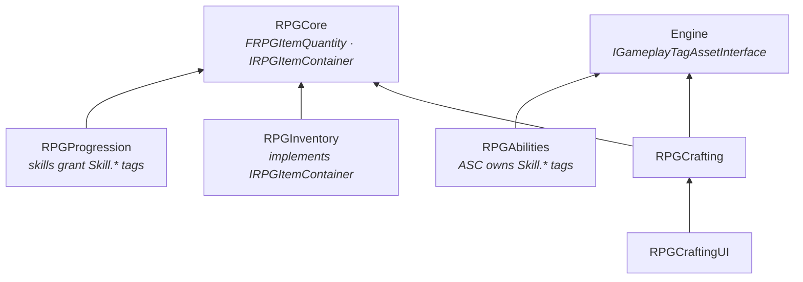

# Crafting System

Recipes as data, all-or-nothing crafting transactions, crafting stations, skill-gated recipes, timed crafting with
cancel and refund, recipe scrolls, and a crafting screen. Crafting reaches items, skills and the UI only through
RPGCore interfaces and the engine's tag interface: it depends on neither Inventory, Progression nor GAS.

| Question | Owner |
|---|---|
| *What goes in, what comes out, where and by whom?* | **`URPGRecipeDefinition`** (data asset) |
| *What does a character know and make?* | **`URPGCraftingComponent`** (on the pawn) |
| *Where is something made?* | **`URPGCraftingStationComponent`** (on a forge, workbench, alchemy table) |
| *How is a recipe learned from an item?* | **`URPGRecipeFragment`** (item fragment) |
| *How does the player see it?* | **`RPGCraftingUI`**: screen, recipe entries, and **`URPGCraftingUIComponent`** (on the PlayerController) |

---

## 1. Modules

```
Plugins/
├── RPGCore/                          FRPGItemQuantity, IRPGItemContainer, URPGCoreStatics::FindInterface
└── RPGCrafting/
    ├── RPGCrafting   (Runtime)       Recipe definition, recipe fragment, crafting & station components, tags
    └── RPGCraftingUI (Runtime)       Crafting screen, recipe entry, crafting UI component (UMG)
```

| Module | Depends on | Why |
|---|---|---|
| `RPGCrafting` | `RPGCore`, `GameplayTags` | Items through `IRPGItemContainer`; skill checks through the engine's `IGameplayTagAssetInterface` |
| `RPGCraftingUI` | `RPGCrafting`, `RPGCore`, `UMG`, `GameplayTags` (+ private `Slate`, `SlateCore`, `InputCore`) | Displays recipes and drives crafting |



**Skill-gated recipes without a dependency:** a Progression skill grants `Skill.Smithing` to the pawn's ability
system component (through `IRPGTagReceiver`); the crafting component asks the pawn for its tags through the engine's
`IGameplayTagAssetInterface`, which the ASC implements. Neither plugin knows the other, and a project without GAS can
implement the interface on any component.

### `FRPGItemQuantity` (RPGCore)

`{ Item, Quantity }`, a shared type for ingredients, outputs and, later, prices and quest rewards.

---

## 2. `URPGRecipeDefinition`

| Property | Description |
|---|---|
| `DisplayName`, `Description` | Optional; empty name = the first output's name |
| `Category` | `Crafting.Category.*`, the UI tab |
| `Ingredients`, `Outputs` | `FRPGItemQuantity` lists; several outputs allowed (by-products) |
| `CraftTime` | Seconds per craft; 0 = instant |
| `RequiredStation` | `Crafting.Station.*`; empty = anywhere |
| `RequiredTags` | All must be owned by the crafter (`Skill.Smithing`, a quest flag, a faction rank...) |

`GetPrimaryOutput()` (the first output) gives the recipe its icon, name and rarity colour in the UI.

| Validation | Severity |
|---|---|
| No outputs, or an entry without an item | Error |
| The same item listed twice | Warning |
| No ingredients, no category | Warning |

Native tags (RPGCrafting): `Crafting.Station.Forge`, `.Workbench`, `.Alchemy`;
`Crafting.Category.Weapons`, `.Armor`, `.Consumables`, `.Materials`. Projects add more in Project Settings.

---

## 3. `URPGCraftingComponent`

Lives on the pawn, next to the inventory. Ingredients come from, and outputs go to, the owner's `IRPGItemContainer`.

### Recipes

| Member | Description |
|---|---|
| `StartingRecipes` | Learned on `BeginPlay` |
| `KnownRecipes` | `SaveGame` |
| `LearnRecipe(Recipe)` | False if null or already known |
| `LearnRecipeFromItem(Item, bConsumeItem)` | Learns the recipe of an item with a **Recipe** fragment, then consumes one. An already known recipe returns false and **keeps** the item |
| `OnRecipeLearned(Recipe)` | |

### Rules: `ERPGCraftResult`

`CanCraft` and every craft use the same check, in this order:

| Result | Meaning |
|---|---|
| `InvalidRecipe` | Null or without outputs |
| `UnknownRecipe` | Not learned |
| `WrongStation` | `RequiredStation` set and the active station is neither it nor a child of it |
| `MissingRequirements` | A `RequiredTags` tag is missing (`GetMissingRequirements` lists them) |
| `NoContainer` | The owner has no item container |
| `MissingIngredients` | Not enough for the requested count (`GetMaxCraftable`) |
| `NoRoom` | Only known **while** crafting (see below) |
| `Busy`, `Cancelled` | Timed crafting |

`GetMaxCraftable` uses integer division on purpose (7 ore / 3 per craft = 2).

### The transaction

Checking "do the outputs fit?" before crafting is wrong, because removing the ingredients can free the space the
outputs need:

```
Inventory 30/30, one slot holds 1 x Wood.    Recipe: 3 Ore + 1 Wood → 1 Sword

check first:  CanAddItem(Sword)? no room          → refused            ✗
transaction:  Ore −3, Wood −1 → Wood slot freed → Sword added → OK  ✓
```

Every single craft is therefore:

1. **Take** the ingredients, recording what was actually removed.
2. **Give** the outputs, recording what was actually added.
3. If either step falls short, **roll back**: remove what was given first (to free space), then return what was taken.

Items are never lost or duplicated. A batch ("make 5") is a series of independent transactions: if the ore runs out
after 3, the 3 swords stay and the result reports `MissingIngredients` with `OutCraftedCount = 3`.

### Stations

| Member | Description |
|---|---|
| `SetActiveStation(Tag, Source)` / `ClearActiveStation()` | Called by stations; `Source` tells two stations with the same tag apart |
| `GetActiveStation()`, `GetActiveStationSource()` | |
| `IsAtRequiredStation(Recipe)` | `ActiveStation.MatchesTag(RequiredStation)`: a `Crafting.Station.Forge.Master` can make every `Forge` recipe, not the other way round |
| `OnActiveStationChanged(Tag)` | |

Changing the station cancels a timed craft that needs the old one; station-less crafts carry on.

### Crafting

| Function | Behaviour |
|---|---|
| `Craft(Recipe, Count, OutCraftedCount)` | Instant, ignores `CraftTime` (tests, scripts) |
| `StartCrafting(Recipe, Count)` | The UI entry point. Instant recipes finish in the same call; timed recipes run one item at a time |
| `CancelCrafting()` | Returns the current item's ingredients; finished items are kept |
| `IsCrafting()`, `GetActiveRecipe()`, `GetCraftProgress()`, `GetCraftedCount()`, `GetRemainingCount()` | Job state |

| Event | When |
|---|---|
| `OnCraftingStarted(Recipe, Count)` | A job started |
| `OnItemCrafted(Recipe, Count)` | Outputs added: once per instant batch, once per item of a timed job |
| `OnCraftingFinished(Recipe, CraftedCount, Result)` | A job ended: `Success`, a failure reason, or `Cancelled` |

Timed jobs take an item's ingredients **when the item starts**, so they cannot be spent twice while the timer runs,
and requirements are re-checked per item. State is reset before `OnCraftingFinished` is broadcast, so a listener can
start the next job immediately; after `OnItemCrafted` the component checks that a listener has not cancelled the job.
`EndPlay` cancels, which returns pending ingredients.

---

## 4. `URPGCraftingStationComponent`

| Member | Description |
|---|---|
| `StationTag`, `DisplayName` | `Crafting.Station.Forge`, "Forge" (the screen title) |
| `MaxUseDistance` | Use ends beyond this distance (default 4 m; 0 = never) |
| `BeginUse(User)` | Sets the user's active station to this one |
| `EndUse()` | Clears it, only if the user is still at **this** station |
| `OnUseStarted`, `OnUseEnded` | |

While in use, a 0.25 s timer ends the use when the user walks away, closes the screen (the active station no longer
points here) or starts using another station.

---

## 5. Recipe scrolls: `URPGRecipeFragment`

A **Recipe** fragment on an `RPGItemDefinition` (`Recipe = DA_Recipe_IronSword`) turns the item into a scroll. It is an
ordinary item: it stacks, drops, appears in loot tables and has a rarity. `URPGRecipeFragment::GetRecipe(Item)`
returns the recipe an item teaches.

The game layer decides when a scroll is read. The template uses the inventory's activation (double-click), in
`WBP_InventoryScreen`:

```
On Entry Activated (Entry)
└─ RPG Crafting → Learn Recipe From Item (Entry.Item, Consume ✓)
   └─ Branch
      ├─ True  → learned, scroll consumed
      └─ False → Is Valid (Get Recipe (Entry.Item))
                 ├─ True  → "You already know this recipe"
                 └─ False → RPG Equipment → Equip From Container (Entry.Item)
```

---

## 6. UI (`RPGCraftingUI`)

### `URPGCraftingUIComponent` (on the PlayerController)

| Member | Description |
|---|---|
| `ScreenWidgetClass`, `ZOrder` | |
| `OpenCrafting()`, `CloseCrafting()`, `ToggleCrafting()`, `IsCraftingOpen()` | |
| `OnCraftingToggled(bIsOpen)` | For game-layer reactions |

- Follows the possessed pawn's crafting component (`OnPossessedPawnChanged`, and again on open in case possession
  happened before it subscribed).
- **Using a station opens the screen; leaving it closes the screen.** Closing the screen leaves the station.
  `bIsOpen` is cleared before the station is cleared, so the resulting station event finds the screen already closed.
- Opening: Game-and-UI input, cursor, look and move input ignored (reference-counted, reset on close).

It must be on the **PlayerController**: the screen belongs to the player, not to the character, and survives respawn.
On any other actor, `OpenCrafting` logs "owner is not a local PlayerController".

### `URPGCraftingScreenWidget`

| Widget | Required | Content |
|---|---|---|
| `RecipeList` (any panel) | ✓ | One `EntryClass` per visible recipe, sorted by name |
| `CraftButton` | ✓ | Enabled when `CanCraft(Recipe, Quantity) == Success` and nothing is crafting |
| `StationText` | | Station `DisplayName`, or "Crafting" |
| `OutputIcon`, `OutputName`, `DescriptionText` | | Primary output; the name in its rarity colour |
| `IngredientList` | | One line per ingredient, "Iron Ore   2 / 3" (have / need × quantity), missing ones in `MissingColor` |
| `RequirementText` | | "Requires: Forge, Smithing"; collapsed when nothing is missing |
| `DecreaseButton`, `IncreaseButton`, `MaxButton`, `QuantityText` | | Quantity, clamped to what can be made |
| `CancelButton`, `CraftProgressBar`, `StatusText` | | Job progress, "Crafting Iron Sword... 2 / 5", result messages |

| Setting | Description |
|---|---|
| `bShowOtherStations` | Also list recipes for other stations (greyed out) |
| `SetCategoryFilter(Tag)` | Category tabs (hierarchical match, empty = all) |
| `RefreshInterval` | Ingredient counts are re-read periodically: items can arrive without a crafting event |
| `BP_OnCraftFinished(Result, Count)` | Designer hook |

The screen is modal (returns `Handled` for clicks on empty space) and rebuilds its list on recipe learned, station
changed and category changed; it refreshes states on crafting events and on the refresh interval.

### `URPGRecipeEntryWidget`

`IconImage`, `NameText` ("Arrow x10", rarity colour), `CountText` ("(3)"), optional `Background` border coloured
`NormalColor` / `SelectedColor`. Recipes that cannot be crafted are drawn at `UnavailableOpacity`. Clicks are reported
with `OnClicked(Entry)`; the screen decides what selection means.

---

## 7. Setup

1. **Items:** materials (`DA_Item_IronOre`, `DA_Item_Wood`) with inventory fragments and world meshes.
2. **Recipes:** `RPGRecipeDefinition` assets, e.g.

| Asset | Ingredients | Outputs | Time | Station | Requires |
|---|---|---|---|---|---|
| `DA_Recipe_Arrows` | 1 Wood, 1 Iron Ore | 10 Arrow | 0 | — | — |
| `DA_Recipe_IronSword` | 3 Iron Ore, 1 Wood | 1 Iron Sword | 2 s | Forge | `Skill.Smithing` |

3. **Pawn:** **RPG Crafting** (`Starting Recipes`). The pawn also needs an item container (RPG Inventory) and, for
   skill-gated recipes, a tag source (RPG Ability System).
4. **PlayerController:** **RPG Crafting UI** (`Screen Widget Class`); an input action → `Toggle Crafting`.
5. **Station:** `BP_Forge` with a mesh (`Interactable` preset), **RPG Interactable** ("Use Forge") and
   **RPG Crafting Station** (`Crafting.Station.Forge`, "Forge"); `On Interacted (Instigator)` → `Begin Use (Instigator)`.
6. **Skill:** `Skill.Smithing` tag; `DA_Skill_Smithing` granting it, placed in the skill tree.
7. **Scroll:** `DA_Item_Recipe_IronSword` with inventory and **Recipe** fragments; wire the inventory activation
   (section 5).
8. **Widgets:** `WBP_RecipeEntry` and `WBP_CraftingScreen` from the C++ bases (names in section 6). Untick
   **Is Focusable** on the buttons.

---

## 8. Design Decisions

| Decision | Reason |
|---|---|
| Transaction with rollback, not "check then act" | Removing ingredients can free space; checking first rejects valid crafts |
| Rollback based on what was actually taken / given | Partial removals and additions are undone exactly |
| Each craft atomic, a batch is not | Finished items from a stopped batch are kept |
| Ingredients taken when a timed item starts | Cannot be spent twice during the timer; cancel has something concrete to return |
| Station as component state, not a craft parameter | The UI filters by it and leaving it cancels timed work |
| `Source` next to the station tag | Two forges with the same tag do not end each other's use |
| Hierarchical station match | Upgraded stations (`Forge.Master`) for free |
| Required tags through the engine interface | Skill-gated recipes with no Progression or GAS dependency |
| `CanCraft` and crafting share one check | The UI can never offer a craft that then fails for a requirement |
| Recipe scroll as a fragment | Scrolls are ordinary items; nothing in RPGCore knows about crafting |
| UI on the PlayerController | Same split as inventory: gameplay on the pawn, presentation on the player |

---

## 9. Known Limitations / Next Steps

- Crafted items are always identical (no quality, durability or random stats); this needs item instances, planned
  before Save / Load.
- Ingredients only come from the crafter's own container (no chests or stash).
- No crafting XP; the game layer can bind `OnItemCrafted` → `AddExperience`.
- A rollback that returns ingredients goes through `AddItem` and shows pickup notifications; rare (only on `NoRoom`).
- The screen re-reads ingredient counts on a timer because `IRPGItemContainer` has no change event.
- Ingredient lines are plain text without icons.
- `RPGCraftingUI` logs to `LogTemp`; it should get its own log category.
- Known recipes live on the pawn, like the inventory; Save / Load will persist them.
- Not replicated (single-player).
