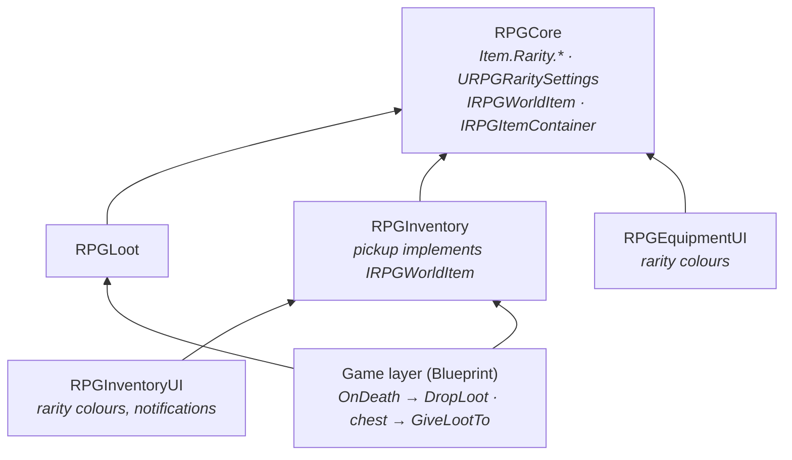

# Loot & Rarity System

Item rarity defined once for the whole project, weighted and nestable loot tables, a simulation command that proves
the drop rates, and a component that turns a roll into pickups in the world or items in a container. Rarity colours
appear in the inventory, equipment slots, tooltips, world pickups and pickup notifications.

| Question | Owner |
|---|---|
| *How rare is an item?* | **`URPGItemDefinition::Rarity`** (an `Item.Rarity.*` tag) |
| *What does a rarity look like and how does it rank?* | **`URPGRaritySettings`** (Project Settings, RPGCore) |
| *What can an enemy or chest give?* | **`URPGLootTable`** (data asset) |
| *Are the drop rates right?* | **`rpg.Loot.Simulate`** console command |
| *When and where does loot appear?* | **`URPGLootComponent`** (on the enemy or chest) |
| *How does loot become a pickup without knowing the pickup class?* | **`IRPGWorldItem`** (RPGCore), implemented by `ARPGItemPickup` |

---

## 1. Modules

```
Plugins/
├── RPGCore/                      Item.Rarity.* tags, URPGRaritySettings, FRPGRarityInfo, IRPGWorldItem,
│                                 URPGCoreStatics::GetRarityInfo / GetItemRarityInfo
└── RPGLoot/
    └── RPGLoot (Runtime)         Loot table, loot component, simulation command
```

| Module | Depends on | Why |
|---|---|---|
| `RPGLoot` | `RPGCore`, `GameplayTags` (+ private `AssetRegistry`) | Rolls tables; spawns pickups through `IRPGWorldItem`, fills containers through `IRPGItemContainer` |
| `RPGCore` | + `DeveloperSettings` | `URPGRaritySettings` is a developer settings page |

**`RPGLoot` depends on neither Inventory nor Interaction.** Inventory implements `IRPGWorldItem` on its pickup;
the game layer connects enemy death and chest interaction to the loot component.



---

## 2. Rarity

### Data

Rarity is a Gameplay Tag on the item definition (`meta = (Categories = "Item.Rarity")`). Its meaning lives in one
place:

**Project Settings → Game → RPG Rarity** (`URPGRaritySettings`, saved to `DefaultGame.ini`)

| Field | Description |
|---|---|
| `Rarities` | `Item.Rarity.*` tag → `FRPGRarityInfo { DisplayName, Color, Tier }` |
| `FallbackRarity` | Used for items without a rarity or with a rarity missing from the map |

| Tag (native, RPGCore) | Colour | Tier |
|---|---|---|
| `Item.Rarity.Common` | Grey | 0 |
| `Item.Rarity.Uncommon` | Green | 1 |
| `Item.Rarity.Rare` | Blue | 2 |
| `Item.Rarity.Epic` | Purple | 3 |
| `Item.Rarity.Legendary` | Orange | 4 |

`Tier` gives rarities an order ("is Rare below Epic?"), which tags alone cannot express. It is used for sorting and
thresholds (world glow) and is ready for loot luck later.

A new rarity (`Item.Rarity.Mythic`) is a new tag and a new row in the settings, without code. `IsDataValid` on the item
warns when an item uses a rarity that is not configured.

### Access

| Function | Description |
|---|---|
| `URPGCoreStatics::GetRarityInfo(Tag)` | Info for a rarity tag (fallback if unknown) |
| `URPGCoreStatics::GetItemRarityInfo(Item)` | Same, for an item (fallback for `nullptr`) |

### Where it is shown

| Place | Widget / actor | How |
|---|---|---|
| Inventory slot | `URPGInventorySlotWidget` | Optional `RarityFrame` image tinted with the colour; hidden for empty slots and items without a rarity |
| Equipment slot | `URPGEquipmentSlotWidget` | Same |
| Tooltip | `URPGItemTooltipWidget` | Name in the rarity colour; optional `RarityText` ("Legendary"), collapsed when there is no rarity |
| World pickup | `ARPGItemPickup` | A small shadowless point light in the rarity colour from `MinGlowTier` up (default Rare); `BP_OnRarityApplied` for richer effects |
| Notifications | `URPGItemNotificationEntryWidget` | "+6 Arrow" in the rarity colour |

Every reusable widget sets **all** of its rarity state on every update, including the empty path (`ClearSlot`), so a
slot that held a Legendary item never keeps the orange frame.

---

## 3. `URPGLootTable`

A Primary Data Asset that only produces a list of `FRPGLootDrop { Item, Quantity }`. What happens with the list is up
to the caller.

| Property | Description |
|---|---|
| `GuaranteedEntries` | Always dropped, every time the table is rolled |
| `MinRolls`, `MaxRolls` | How many times the weighted pool is rolled |
| `NothingWeight` | Weight of "no drop" in the pool |
| `Entries` | The weighted pool |

Each `FRPGLootEntry` holds **either** an `Item` with `MinQuantity` / `MaxQuantity`, **or** a `NestedTable` that is
rolled in its place, plus a `Weight`. The editor greys out the field that does not apply.

### Example

```
DA_LootTable_Goblin        Rolls 1–2, Nothing 50
├─ Arrow (3–8)        w60   40.0 %
├─ Iron Sword         w25   16.7 %
├─ Leather Armor      w10    6.7 %
└─ ▶ DA_LootTable_Rare w5    3.3 %   →  Legendary w1 / Epic w3
                             33.3 % nothing
```

The percentages are calculated by the editor (`Chance per Roll %`, transient and editor-only) whenever the asset is
loaded or edited.

### Rolling

| Function | Description |
|---|---|
| `RollLoot(Seed = -1)` *(Blueprint)* | Seed `< 0` = random; the same seed always gives the same result |
| `Roll(Stream, OutDrops)` *(C++)* | Rolls with a caller-owned `FRandomStream` |

- **Weighted pick:** the weights are laid end to end on `[0, Total)` with "nothing" last; one random number decides.
  Weights do not need to add up to 100, and adding an entry does not require editing the others.
- If `NothingWeight` is 0 and float rounding pushes the pick past the last entry, the last entry is returned, so a
  table without "nothing" never rolls empty.
- **Drops of the same item are merged** (3 + 5 arrows → one drop of 8).
- **Nested tables** are rolled recursively. `IsDataValid` reports cycles (it tracks the current path, so two tables
  sharing a sub-table are not a cycle), and `MaxNestingDepth` (8) stops a roll at runtime if a cycle slips through.

### Validation

| Problem | Severity |
|---|---|
| An entry has both `Item` and `NestedTable` | Error |
| The table contains itself through nested tables | Error |
| An entry is empty | Warning |
| `MaxQuantity < MinQuantity`, `MaxRolls < MinRolls` | Warning |

---

## 4. Simulation: `rpg.Loot.Simulate`

```
rpg.Loot.Simulate <TableNameOrPath> [Count=10000] [Seed=random]
```

Rolls a table many times and logs, per item, how often it dropped **per kill**, the average quantity when it did, and
its rarity. Works in the editor without PIE (it needs no world). Compiled out of shipping builds.

```
LogRPGLoot: Loot simulation: DA_LootTable_Goblin x10000 (seed 18734) in 4.2 ms
LogRPGLoot:   Item                           Drop %    Avg qty  Rarity
LogRPGLoot:   Arrow                          51.87%        6.4  Common
LogRPGLoot:   Iron Sword                     23.41%        1.0  Uncommon
LogRPGLoot:   Leather Armor                   9.93%        1.0  Rare
LogRPGLoot:   Dragon Blade                    1.21%        1.0  Legendary
LogRPGLoot:   (nothing)                      22.35%
```

Per-kill rates are higher than the per-roll percentages when a table rolls more than once:
`P = 0.5·p + 0.5·(1 − (1 − p)²)` for 1–2 rolls (40 % per roll → 52 % per kill). With rolls set to 1–1 the simulation
matches the editor percentages, which is how the weighting was verified. The seed is printed, so any result can be
reproduced exactly.

---

## 5. `URPGLootComponent`

| Property | Description |
|---|---|
| `LootTable` | The table to roll |
| `PickupClass` | Spawned once per drop; must implement `IRPGWorldItem` (`MustImplement` filters the picker) |
| `ScatterRadius` | How far from the owner drops land |
| `bLootOnce` | Loot can be generated only once (enemies, chests) |
| `OnLootDropped(Component, Drops)` | After loot was generated, in either mode |

| Function | Behaviour |
|---|---|
| `DropLoot()` | Rolls and spawns a pickup per drop on a circle around the owner, snapped to the ground |
| `GiveLootTo(Receiver)` | Rolls and adds everything to the receiver's `IRPGItemContainer`. **What does not fit is dropped around the owner.** If the receiver has no container, nothing is rolled and the loot is kept |

- `TryRollLoot` is the single gate for both modes: it checks `bLootOnce`, marks the component as looted **before**
  rolling (an empty roll still counts), and rolls.
- Pickups are spawned with `SpawnActorDeferred` → `IRPGWorldItem::InitializeWorldItem` → `FinishSpawning`, so the
  pickup's `OnConstruction` already knows its item and picks the right mesh.
- Drop positions: evenly spaced around a circle with jitter, then a downward trace that ignores the owner, because a
  character's location is the capsule centre, about a metre above the floor.

### `IRPGWorldItem` (RPGCore)

```cpp
virtual void InitializeWorldItem(const URPGItemDefinition* Item, int32 Quantity) = 0;
```

A C++-only interface (like `IRPGStatReceiver`). Named `WorldItem` rather than `ItemPickup` because Unreal strips the
`A` / `U` / `I` prefix to name the reflected class: `IRPGItemPickup` would produce the class name `RPGItemPickup`, which
`ARPGItemPickup` already uses.

---

## 6. Game layer

### Enemy

```
On Death (RPG Health) ──► RPG Experience Reward → Grant Reward (Killer) ──► RPG Loot → Drop Loot
```

### Chest (`BP_LootChest`)

| Component | Setup |
|---|---|
| `Base`, `Lid` (static meshes) | `Interactable` collision preset |
| `RPG Interactable` | Prompt "Open", Single Use |
| `RPG Loot` | `DA_LootTable_Chest`, `BP_ItemPickup` |

```
On Interacted (Instigator)
└─ bGiveDirectly ? Give Loot To (Instigator) : Drop Loot
   → Open Lid (timeline on the lid hinge)
```

`bGiveDirectly` is instance-editable, so each placed chest chooses its mode.

### Pickup notifications

`URPGInventoryComponent::OnItemsReceived(Item, Quantity)` fires once per `AddItem` call with the **net amount added**
(12 tried, 10 fitted → 10). It is not fired for starting items. `URPGItemNotificationWidget` (in the HUD) listens to
the possessed pawn's inventory and shows "+10 Arrow" lines that merge repeats of the same item, fade out after
`DisplayTime`, and are capped at `MaxEntries`. Because it is tied to the inventory and not to loot, pickups, chests
and future quest rewards all produce the same notification.

---

## 7. Setup

1. **Rarity:** fill *Project Settings → Game → RPG Rarity*; set `Rarity` on items.
2. **Tables:** create `RPGLootTable` assets; check them with `rpg.Loot.Simulate`.
3. **Pickup:** `BP_ItemPickup` from `RPGItemPickup`; set `Fallback Mesh` and optionally `Min Glow Tier`.
4. **Enemy:** add `RPG Loot` (table, `BP_ItemPickup`) and call `Drop Loot` from `On Death`.
5. **Chest:** `BP_LootChest` as above.
6. **UI:** add a `RarityFrame` image to the slot WBPs and `RarityText` to the tooltip; add
   `WBP_ItemNotifications` (parent `RPGItemNotificationWidget`, entry class `WBP_ItemNotificationEntry`) to the HUD.

Every item that can be dropped needs a `WorldMesh` in its inventory fragment. Items without one use the pickup's
`FallbackMesh` and log a warning, so a missing mesh shows up as a visible box instead of an invisible pickup.

---

## 8. Design Decisions

| Decision | Reason |
|---|---|
| Rarity per item definition, not per dropped copy | Items are data assets; per-copy rarity needs an item-instance system (see limitations) |
| Rarity meaning in developer settings | One source for colours in every UI and in the world; changing a colour touches one place |
| Native rarity tags, values in ini | Tags are a cross-system contract; native tags may not be registered yet when the settings CDO is built |
| Weights instead of percentages | Adding an entry does not require rebalancing the others |
| Seeded `FRandomStream` | Reproducible results for tests, bug reports and the simulation command |
| Table only returns a list | Spawning, giving and filling chests are separate decisions; the same table serves enemies, chests and rewards |
| Simulation command | Drop rates are measured, not guessed |
| `IRPGWorldItem` in RPGCore | Loot spawns pickups without depending on the Inventory plugin |
| Leftovers are dropped, never discarded | Same rule as inventory dropping: the player never silently loses items |
| Container checked before rolling in `GiveLootTo` | A call with the wrong receiver does not use up a chest |
| Notifications from `OnItemsReceived` | One hook covers every way items enter the inventory |
| Glow only from a tier up, without shadows | Readable loot piles and a negligible lighting cost |

---

## 9. Known Limitations / Next Steps

- Rarity belongs to the item definition; random rarity or affixes per dropped copy need item instances (planned with
  Crafting).
- No currency drops yet; `IRPGCurrencyHolder` exists in RPGCore and will be connected with the Economy system.
- No loot luck / magic find; `Tier` is in place for shifting weights by rarity.
- Loot tables are rolled at drop time; a chest's content is not visible or persistent before it is opened (Save / Load).
- Unequipping also triggers a pickup notification, because it goes through `AddItem`; an "add reason" could filter it.
- `DropLoot` does not avoid walls: on a narrow ledge, drops can land below or behind geometry.
- Not replicated (single-player).
