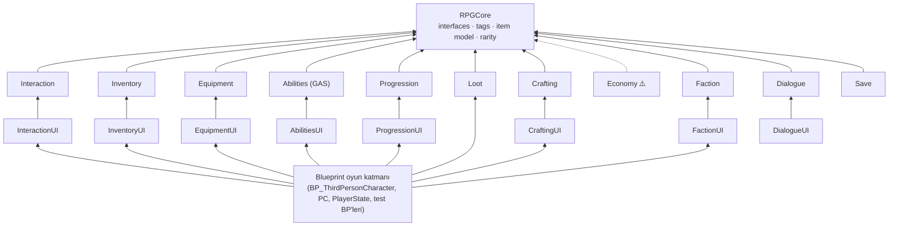

# RPGTemplate: Proje İndeksi

> Kod tabanının tamamı okunarak çıkarıldı (21 Ekim 2026, `main` @ `e42a5ed` + commit edilmemiş değişiklikler).
> Amaç: "ne nerede, ne için var, neye bağlı" sorusuna tek yerden cevap. Sistem dokümanlarının yerine geçmez; onlara yönlendirir.

---

## 0. Bir bakışta

| | |
|---|---|
| Motor | Unreal Engine **5.7** (`EngineAssociation: 5.7`, build 5.7.4) |
| Dil | C++ (plugin'ler) + Blueprint (oyun katmanı: karakter, controller, UI, test aktörleri) |
| Kod | ~16.600 satır C++, **12 plugin / 21 modül** + boş game modülü `Source/RPGTemplate` |
| Harita | `L_Sandbox` (varsayılan + editör açılış haritası), GameMode override: `BP_GameMode` |
| Bağımlılık | Engine: `GameplayAbilities` (GAS), `GameplayTags`, `EnhancedInput`, `DeveloperSettings`, `UMG` |
| Ağ | Tek oyunculu. Hiçbir şey replike edilmiyor |

| Sistem | Plugin | Durum |
|---|---|---|
| Çekirdek (tag, interface, item modeli) | `RPGCore` | ✅ commit'li (+ yeni `IRPGReputationHolder`, değişen `IRPGSaveable`) |
| Etkileşim | `RPGInteraction` (+UI) | ✅ |
| Envanter | `RPGInventory` (+UI) | ✅ |
| Ekipman | `RPGEquipment` (+UI) | ✅ |
| Yetenek & Stat (GAS) | `RPGAbilities` (+UI) | ✅ |
| İlerleme (XP, skill tree) | `RPGProgression` (+UI) | ✅ |
| Loot & Nadirlik | `RPGLoot` | ✅ |
| Crafting | `RPGCrafting` (+UI) | ✅ |
| Ekonomi | `RPGEconomy` | 🟡 Runtime derleniyor (22 Ekim'de tamamlandı); UI ve content yok (bkz. §12) |
| Fraksiyon & İtibar | `RPGFaction` (+UI) | 🟡 Derlendi, commit edilmedi |
| Diyalog | `RPGDialogue` (+UI) | 🟡 Derlendi, commit edilmedi, content'e bağlanmadı |
| Kayıt / Yükleme | `RPGSave` | 🟡 Derlendi, commit edilmedi, content'e bağlanmadı |

---

## 1. Mimari kurallar (kodda gerçekten uygulanıyor)

1. **Sistem plugin'leri yalnızca `RPGCore`'a bağlı.** Hiçbir sistem başka bir sistemi `#include` etmiyor; `Build.cs` buna izin vermiyor.
2. **Sistemler arası iletişim = RPGCore interface'leri + delegate'ler + Gameplay Tag'ler.** Interface bulma her yerde
   `URPGCoreStatics::FindInterface<I, UI>(Actor)` ile: önce aktörün kendisi, sonra component'leri.
3. **Runtime ve UI ayrı modül.** Runtime modülleri UMG'ye bağlı değil.
4. **Data > kod.** Item, recipe, loot table, skill, faction, dialogue: hepsi `UPrimaryDataAsset`. Ayarlar `UDeveloperSettings`.
5. **Tick yok.** Hepsi event/timer tabanlı. İstisnalar: Interactor (sadece hold sırasında), prompt/notification widget'ları.
6. **"Snapshot by source" köprüleri.** Stat ve tag veren her sistem kendi `this`'iyle anahtarlanmış tam bir snapshot gönderiyor;
   yeni snapshot eskisini değiştiriyor. Kaynaklar birbirinin üzerine yazmıyor.
7. **"State first, then broadcast"** ve **transaction + rollback** (envanter, ekipman, crafting, ticaret). Kod yorumlarında sürekli geçiyor.
8. **Sync on subscribe**: UI/observer'lar bağlandıkları an `Refresh()` çağırıyor; `OnPossessedPawnChanged` / `OnPawnSet` ile respawn'a dayanıklı.



> `Source/RPGTemplate` C++ modülü **boş** (sadece `IMPLEMENT_PRIMARY_GAME_MODULE`). README'deki "Game module wires systems together"
> fiilen **Blueprint'lerde** yapılıyor.

---

## 2. RPGCore sözleşmeleri: kim implement ediyor, kim kullanıyor

| Interface (RPGCore) | Ne | Implement eden | Kullanan |
|---|---|---|---|
| `IRPGInteractable` (BP-implementable) | `CanInteract / GetInteractionPrompt / GetInteractionDuration / Interact` | `URPGInteractableComponent`, `ARPGItemPickup` | `URPGInteractorComponent`, detector'lar, prompt widget |
| `IRPGItemContainer` (C++) | `GetItemCount / CanAddItem / AddItem / RemoveItem` (+`HasItem`) | `URPGInventoryComponent` | Pickup, Equipment, Loot, Crafting, Economy, Dialogue |
| `IRPGWorldItem` (C++) | `InitializeWorldItem(Item, Qty)` (deferred spawn) | `ARPGItemPickup` | `URPGLootComponent` |
| `IRPGStatReceiver` (C++) | `SetStatModifiers(Source, Mods)` | `URPGAbilitySystemComponent` | Equipment, Progression |
| `IRPGTagReceiver` (C++) | `SetGrantedTags(Source, Tags)` | `URPGAbilitySystemComponent` | Progression (skill tag), Faction (rank tag), Dialogue (flag tag) |
| `IRPGItemTooltip` (BP-implementable) | `SetTooltipItem(Item, Qty)` | `URPGItemTooltipWidget` | `URPGEquipmentSlotWidget` (InventoryUI'ı tanımadan) |
| `IRPGCurrencyHolder` (C++) | `GetCurrency / AddCurrency / SpendCurrency` (+`CanAfford`), tag `const&` | `URPGWalletComponent` | Merchant, CurrencyReward, Dialogue |
| `IRPGReputationHolder` (C++, **yeni**) | `GetReputation / AddReputation`, `static Find(Actor)` (actor → pawn/controller/instigator → PlayerState) | `URPGReputationComponent` | FactionMember, Dialogue |
| `IRPGSaveable` (C++, **değişti**) | `OnBeforeSave()`, `OnLoadedFromSave()` (ikisi de opsiyonel) | Interactable, Inventory, Equipment, Crafting, Progression, ExperienceReward, Loot, Wallet, Merchant, CurrencyReward, Reputation, FactionMember, Dialogue | `URPGSaveSubsystem` |
| Engine: `IGameplayTagAssetInterface` | Sahip olunan tag'ler | ASC | Crafting (`RequiredTags`), Dialogue (`Has Tags`) |

**Diğer RPGCore tipleri**

| Tip | Dosya | Not |
|---|---|---|
| `URPGItemDefinition` (PrimaryDataAsset, Const) | `Items/RPGItemDefinition.h` | DisplayName, Description, Icon (soft), `ItemType` (`Item.Type.*`), `Rarity` (`Item.Rarity.*`), `ItemTags`, `MaxStackSize`, `Fragments` (instanced). Asset type `"Item"`, `/Game/Items` taranıyor. `IsDataValid` var |
| `URPGItemFragment` (abstract, EditInlineNew) | `Items/RPGItemFragment.h` | Davranış kompozisyonu (boş base; stat `Modifiers` Equipment fragment'inde) |
| `FRPGItemQuantity` | `Items/RPGItemQuantity.h` | Item + adet (recipe, ödül) |
| `FRPGStatModifier` | `Stats/RPGStatModifier.h` | `Stat` tag + `Value` |
| `URPGRaritySettings` | `Items/RPGRaritySettings.h` | Project Settings → Game → RPG Rarity. Tag → (isim, renk, tier). `DefaultGame.ini`'de 5 kademe tanımlı |
| `URPGCoreStatics` | `RPGCoreStatics.h` | Interface bulucular + BP erişimi (`GetItemCount`, `AddItem`, `RemoveItem`, `GetCurrency`, `SpendCurrency`, `GetRarityInfo`, `GetItemRarityInfo`) |
| `RPGTags::*` | `RPGCoreTags.h/.cpp` | Çapraz sistem native tag'ler (bkz. §9) |

---

## 3. Plugin plugin indeks

Yollar `Plugins/<Plugin>/Source/<Modül>/{Public,Private}/...` altında.

### 3.1 RPGInteraction (+ RPGInteractionUI)
Oyuncu bir objeye odaklanır → highlight → dünyaya bağlı prompt → anlık veya basılı tutmalı etkileşim.

| Sınıf | Nereye | Görev |
|---|---|---|
| `URPGInteractorComponent` | Pawn | `ScanInterval` (0.1 s) timer'ıyla detector'a sorar, focus'u tutar. `StartInteraction / StopInteraction`, hold (tick sadece hold'da). Event: `OnFocusChanged`, `OnHoldStarted`, `OnHoldEnded`, `OnPromptChanged` |
| `URPGInteractionDetector` (abstract, instanced) | Interactor'da | Strateji. `ResolveInteractable` (actor ya da component'teki interface + `CanInteract`) |
| `URPGTraceInteractionDetector` | ↑ | Kameradan sphere sweep, `MaxReachFromInstigator` |
| `URPGOverlapInteractionDetector` | ↑ | Yarıçap içinde skor (mesafe + açı), mevcut focus bonusu (hysteresis), line of sight |
| `URPGInteractableComponent` | Etkileşilebilir aktör | Prompt, `HoldDuration`, `bSingleUse`, `HighlightStyle`, `OnInteracted(Instigator)` |
| `URPGHighlighterComponent` | Pawn | Focus'taki mesh'lere CustomDepth stencil (`ERPGHighlightStyle` = stencil değeri). `Highlight` component tag'i ile mesh seçimi |
| `URPGInteractionLibrary` | BP lib | `GetActorFromInteractable` |
| `RPGInteractionDebug` | private | CVar `rpg.Interaction.Debug` |
| `URPGInteractionPromptComponent` (UI) | PlayerController | Prompt widget'ı yaratır, possess değişince Interactor'a yeniden bağlar, `SetPromptSuppressed` |
| `URPGInteractionPromptWidget` (UI) | WBP base | Aktör bounds üstüne projeksiyon, hold progress. BindWidget: `PromptText`, opsiyonel `HoldProgressBar` |

Content (plugin içinde): `M_InteractionOutline`, `MI_InteractionOutline`, `MF_SampleStencilOffset`, `M_HighlightDebug`, `UI/WBP_InteractionPrompt`.
Collision: trace kanalı **`Interaction`** (`ECC_GameTraceChannel1`), profil **`Interactable`**. `r.CustomDepth=3` açık.

### 3.2 RPGInventory (+ RPGInventoryUI)
Liste tabanlı, slot + ağırlık limitli envanter. Grid sadece UI'da.

| Sınıf | Görev |
|---|---|
| `URPGInventoryComponent` (Pawn; `IRPGItemContainer`, `IRPGSaveable`) | `Entries` (`FRPGItemEntry`: Guid, Item, Qty; **SaveGame**). `MaxSlots`, `bUseWeight`, `MaxWeight`, `bAllowOverweight`, `StartingItems`, `PickupClass`, `DropDistance`. `ComputeAddableQuantity` = min(istek, ağırlık, slot) → kısmi ekleme. `DropEntry` önce spawn sonra remove (kayıpsız). Event: `OnItemAdded`, `OnItemRemoved`, `OnWeightChanged`, `OnInventoryRefreshed`, `OnItemsReceived` (bildirim akışı) |
| `URPGInventoryFragment` | `Weight`, `bCanBeDropped`, `WorldMesh`; `GetUnitWeight(Item)` |
| `ARPGItemPickup` (`IRPGInteractable`, `IRPGWorldItem`) | Dünya item'ı. Canlı prompt ("Pick up X x12" / "Inventory Full"), kalan miktarı tutar, nadirlik ışığı (`MinGlowTier`=2), `BP_OnRarityApplied` |
| UI: `URPGInventoryUIComponent` (PC) | Ekranı aç/kapa, input mode, `OnInventoryToggled` (oyun katmanı prompt'u gizlemek için) |
| UI: `URPGInventoryScreenWidget` | Grid + ağırlık barı + kategori filtresi (`SetFilter(Item.Type.*)`), `OnEntryActivated` (çift tık → equip/okuma) |
| UI: `URPGInventoryGridWidget` / `URPGInventorySlotWidget` | Slot havuzu; sağ tık drop (Shift = tüm stack), çift tık activate, rarity frame, tooltip |
| UI: `URPGItemTooltipWidget` (`IRPGItemTooltip`) | İsim (nadirlik rengi), nadirlik, açıklama, toplam ağırlık |
| UI: `URPGItemNotificationWidget` / `...EntryWidget` | "+6 Arrow" akışı, aynı item birleşir, fade |

### 3.3 RPGEquipment (+ RPGEquipmentUI)
Tag tabanlı slotlar, container ile kayıpsız transfer, mesh bağlama, stat modifier.

| Sınıf | Görev |
|---|---|
| `URPGEquipmentComponent` (Pawn; `IRPGSaveable`) | `AvailableSlots` (`Equipment.Slot.*`, insansı varsayılanlar), `StartingEquipment`, `EquippedItems` (**SaveGame**). `EquipFromContainer` / `UnequipToContainer` → `ERPGEquipResult`. Swap'ta rollback. Her değişimde `PushStatModifiers()` → `IRPGStatReceiver`. Event: `OnEquipmentChanged(Slot, New, Old)` |
| `URPGEquipmentFragment` | `EquipSlot`, `AttachedStaticMesh` / `AttachedSkeletalMesh`, `AttachSocket` (+ base'teki `Modifiers`) |
| `URPGEquipmentVisualsComponent` (Pawn) | Static mesh → socket, skeletal mesh → Leader Pose. Collision yok. Hedef mesh: `EquipmentTarget` tag'i ya da ilk skeletal mesh |
| UI: `URPGEquipmentPanelWidget` / `URPGEquipmentSlotWidget` | Panel widget tree'deki slotları kendisi bulur; çift tık unequip; stat özeti; tooltip `IRPGItemTooltip` üzerinden |

### 3.4 RPGAbilities (+ RPGAbilitiesUI), GAS
| Sınıf | Görev |
|---|---|
| `URPGAbilitySystemComponent` (Pawn; `IRPGStatReceiver`, `IRPGTagReceiver`) | `DefaultAttributeSets` (InitializeComponent'te), `DefaultEffects` (BeginPlay; `GE_InitStats`, `GE_StaminaRegen`), `DefaultAbilities` (InputTag → DynamicSpecSourceTags). `StatModifierEffect` (`GE_StatModifiers`): kaynak başına bir SetByCaller GE. `SetGrantedTags`: kaynak başına loose tag. `AbilityInputTagPressed/Released` |
| `URPGHealthSet` | Health, MaxHealth, **IncomingDamage** (meta). Clamp hem base hem current; `PostGameplayEffectExecute` hasarı Health'e çevirir, öldürücü darbede `DamageInstigator`'ı saklar |
| `URPGStaminaSet` | Stamina, MaxStamina (clamp) |
| `URPGCombatSet` | Damage, Armor |
| `URPGDamageExecution` | `max(Source.Damage + SetByCaller.Damage − Target.Armor, MinimumDamage)` → IncomingDamage |
| `URPGGameplayAbility` | Base: `InputTag`, InstancedPerActor, `State.Dead` ile bloklu |
| `URPGMeleeAbility` | Montage (+ `Event.Melee.Hit` notify) ya da `HitDelay`; sphere trace, aktör başına tek hit, `GE_Damage` |
| `URPGHealthComponent` | Health attribute'unu `OnHealthChanged(.., Instigator)` / `OnDeath(Dead, Killer)`'a çevirir, `State.Dead` ekler |
| UI: `URPGAttributeBarWidget` | Herhangi bir Value/Max attribute çifti, possessed pawn'ı takip eder |

Content: `GAS/GA_MeleeAttack`, `GA_Dodge`, `GE_Damage`, `GE_InitStats`, `GE_StaminaRegen`, `GE_StatModifiers`, `GE_DodgeCost`, `GE_DodgeCooldown`, `GE_Test_*`; `Dummy/GE_InitStats_Dummy`.
Config: `DefaultRPGAbilities.ini` (eski `HealthComponent` → `RPGHealthComponent` redirect).

### 3.5 RPGProgression (+ RPGProgressionUI)
| Sınıf | Görev |
|---|---|
| `URPGProgressionComponent` (**PlayerState**; `IRPGSaveable`) | `ExperienceCurve` (`C_ExperiencePerLevel`), Start/MaxLevel, `SkillPointsPerLevel`, `StatsPerLevel` (×(Level−1)), `SkillTree`. Kaydedilen: `Level`, `Experience`, `SkillPoints`, `UnlockedSkills`. `AddExperience` çoklu level atlar. `UnlockSkill` → `ERPGSkillUnlockResult`. `PushToTarget()` = stat snapshot (`IRPGStatReceiver`) + skill tag snapshot (`IRPGTagReceiver`); `OnPawnSet`'te tekrar gönderir |
| `URPGSkillDefinition` | Cost, RequiredLevel, Prerequisites, StatModifiers, `GrantedTags` (`Skill.*`) |
| `URPGSkillTreeDefinition` | Node'lar (skill + ekran pozisyonu); bağlantılar prerequisite'ten |
| `URPGExperienceRewardComponent` (Düşman; `IRPGSaveable`) | `GrantReward(Killer)` bir kez; `bRewardGranted` SaveGame |
| UI: `URPGExperienceBarWidget`, `URPGSkillNodeWidget` (Locked/Available/Unlocked), `URPGSkillTreeWidget` (`NativePaint` ile prerequisite çizgileri) |

Skill → yetenek kilidi kodsuz: skill `Skill.Dodge` verir, `GA_Dodge` `ActivationRequiredTags` ile ister.
Content: `GAS/DA_Skill_{Dodge,Endurance,Strength,Toughness}`, `GAS/DA_SkillTree_Default`.

### 3.6 RPGLoot
| Sınıf | Görev |
|---|---|
| `URPGLootTable` (PrimaryDataAsset) | `GuaranteedEntries`, `Min/MaxRolls`, `NothingWeight`, ağırlıklı `Entries` (item **veya** nested table, adet aralığı). Seed'li `FRandomStream`; aynı item birleşir. Editörde roll başına % hesaplar; `IsDataValid` döngü tespiti; runtime `MaxNestingDepth=8` |
| `URPGLootComponent` (`IRPGSaveable`) | `DropLoot()` (etrafa saçar, zemine oturtur, `IRPGWorldItem` ile spawn) / `GiveLootTo(Receiver)` (container'a, sığmayan yere düşer). `bLootOnce`, `bHasLooted` (SaveGame) |
| `rpg.Loot.Simulate <Table> [Count] [Seed]` | Drop oranı simülasyonu (Shipping hariç) |

Content: `Loot/DA_LootTable_Goblin`, `DA_LootTable_Rare`, `DA_LootChest`.

### 3.7 RPGCrafting (+ RPGCraftingUI)
| Sınıf | Görev |
|---|---|
| `URPGRecipeDefinition` | Ingredients, Outputs, `CraftTime`, `Category` (`Crafting.Category.*`), `RequiredStation` (`Crafting.Station.*`), `RequiredTags` |
| `URPGCraftingComponent` (Pawn; `IRPGSaveable`) | `KnownRecipes` (SaveGame), `LearnRecipe(FromItem)`. Anlık `Craft()` ve zamanlı `StartCrafting()` (malzeme item başlarken alınır, iptalde iade). Her craft all-or-nothing: Take → Give → Rollback (önce çıktılar geri alınır). Aktif istasyon: hiyerarşik tag eşleşmesi (`Forge.Master` ⊇ `Forge`). `ERPGCraftResult` |
| `URPGCraftingStationComponent` | `BeginUse(User)` → kullanıcının aktif istasyonu; 0.25 s'de bir mesafe/kaynak kontrolü |
| `URPGRecipeFragment` | Item'ı tarif parşömenine çevirir |
| UI: `URPGCraftingUIComponent` (PC), `URPGCraftingScreenWidget`, `URPGRecipeEntryWidget` | İstasyon aktif olunca ekran otomatik açılır, kapanınca istasyon bırakılır |

Content: `Items/BP_Forge`, `Items/recipe/DA_Recipe_{IronSword,Arrows}`, `DA_Item_Recipe_IronSword`.

### 3.8 RPGEconomy (runtime only)
Dosyalar: `RPGWalletComponent`, `RPGMerchantComponent`, `RPGCurrencyRewardComponent`, `RPGEconomyTypes.h` (`ERPGTradeResult`, `FRPGCurrencyInfo`, `FRPGMerchantStockEntry`),
`RPGEconomySettings` (Project Settings → Game → RPG Economy), `Items/RPGValueFragment` ("Value" fragment), `RPGEconomyLibrary`.
Tasarım: Wallet = tag başına bakiye (boş tag = varsayılan para, overflow guard); Merchant = stok, alış/satış çarpanları (yukarı/aşağı yuvarlama),
kabul edilen item tipleri, buy-back, sonsuz/sonlu kasa, her işlem all-or-nothing; CurrencyReward = rastgele miktar, bir kez.
Fiyat = `Value` fragment × nadirlik çarpanı (ayarlarda) × merchant'ın alış/satış çarpanı. **Ticaret ekranı (`RPGEconomyUI`) yok.**

### 3.9 RPGFaction (+ RPGFactionUI)
| Sınıf | Görev |
|---|---|
| `URPGFactionSettings` | Project Settings → Game → RPG Factions: `Factions` (soft ref listesi), Min/MaxReputation (±1000) |
| `URPGFactionDefinition` | `FactionTag`, isim, ikon, `StartingReputation`, `bShowInUI`, `Ranks` (sıralı; `GrantedTag`, `bHostile`, renk), `Relations` (çarpanla tek seviye yayılım) |
| `URPGReputationComponent` (**PlayerState**; `IRPGReputationHolder`, `IRPGSaveable`) | `Reputation` map (SaveGame). Tek kapı `SetReputationInternal` (clamp, rank değişimi). Rank tag'lerini pawn'a `IRPGTagReceiver` ile iter. Event: `OnReputationChanged`, `OnRankChanged` |
| `URPGFactionMemberComponent` (NPC) | `Faction`, `KillReputationChange`, `ReportKilledBy(Killer)`, `IsHostileTo(Other)` |
| Konsol | `rpg.Reputation.Add <Tag> <Amount>`, `rpg.Reputation.Print` |
| UI: `URPGReputationPanelWidget`, `URPGReputationEntryWidget` | Fraksiyon listesi, rank rengi, sonraki rank'a ilerleme |

Content: `NewFolder/DA_Faction_Bandits`, `NewFolder/DA_Faction_Village`. Tag'ler: `Faction.{Bandits,Village}`, `Reputation.<Faction>.<Rank>`.

### 3.10 RPGDialogue (+ RPGDialogueUI)
| Sınıf | Görev |
|---|---|
| `URPGDialogueAsset` | `StartNode`, `ConditionalStarts`, `Nodes` (`Id`, SpeakerName, Text, `OnEnterActions`, `Choices`, `NextNode`). `IsDataValid`: id tekilliği, kırık referans, erişilemeyen node |
| `URPGDialogueComponent` (**PlayerController**; `IRPGSaveable`) | Tek konuşma yürütür. `StartDialogue / SelectChoice / Continue / EndDialogue`, `MaxTalkDistance`. `Flags` (SaveGame) → `bGrantFlagsAsTags` ile pawn'a tag. `SendEvent(Tag, bWaitForDialogueEnd)` (ör. ticareti diyalog kapandıktan sonra aç) |
| `URPGDialogueSpeakerComponent` (NPC) | İsim, portre, `Dialogue` asset, `StartDialogueWith(Player)`, `OnDialogueEvent`, `OnTalkStarted/Ended` |
| Koşullar (`URPGDialogueCondition`, `bInvert`) | `HasFlags`, `HasTags`, `HasItem`, `HasCurrency`, `Reputation At Least`, `Blueprint Condition` |
| Aksiyonlar (`URPGDialogueAction`) | `SetFlags`, `ChangeItem`, `ChangeCurrency`, `ChangeReputation`, `SendEvent`, `Blueprint Action` |
| UI: `URPGDialogueUIComponent` (PC), `URPGDialogueScreenWidget`, `URPGDialogueChoiceWidget` | Ekran, numara/Space/Escape tuşları |

Native tag'ler: `Dialogue.Event`, `Dialogue.Event.Trade`, `Dialogue.Flag`. Görsel graph editörü yok (bilinçli olarak ertelendi).

### 3.11 RPGSave
| Sınıf | Görev |
|---|---|
| `URPGSaveSubsystem` (GameInstanceSubsystem) | `SaveToSlot / LoadFromSlot / DoesSaveExist / DeleteSave / GetSaveInfo / ResetWorldState`. Sadece `UPROPERTY(SaveGame)` serileştirilir (`ArIsSaveGame`, `ArNoDelta`, obje referansları path olarak) |
| `URPGSaveGame` | `SaveVersion` (=1), zaman, `MapName`, oyuncu transform + control rotation, `Objects` (key → byte), `DestroyedActors`, `ActorTransforms` |
| `URPGSaveableActorComponent` | **Level'e yerleştirilmiş** aktörlere: yok edilmeyi, opsiyonel transform'u, `IRPGSaveable` component'lerini kaydettirir. Key = PIE prefix'siz actor path |
| Konsol | `rpg.Save [Slot]`, `rpg.Load [Slot]` (varsayılan `Quick`) |

Kaydedilen hedefler: `Controller/<Comp>`, `Pawn/<Comp>`, `PlayerState/<Comp>`, `World/<ActorPath>/<Comp>` (+ her aktörün kendi SaveGame BP değişkenleri `@Actor`).
Yükleme: haritayı **yeniden açar** → bir tick sonra (pawn bekleyerek, 60 deneme) yok edilenleri siler, transform'ları uygular,
önce tüm veriyi geri yükler, **sonra** `OnLoadedFromSave` çağırır.

---

## 4. Stat / tag köprüleri (kim kime ne gönderiyor)

```
Equipment ─┐  SetStatModifiers(this, …)      ┌─> ASC: kaynak başına 1 × GE_StatModifiers (SetByCaller, Stat.* tag'leri)
Progression┘  (level×StatsPerLevel + skill)  │
                                              │
Progression ─┐ SetGrantedTags(this, Skill.*) ├─> ASC: kaynak başına loose tag seti
Reputation  ─┤ (Reputation.<F>.<Rank>)       │      → GA ActivationRequiredTags, Crafting RequiredTags,
Dialogue    ─┘ (flag'ler)                    ┘        Dialogue "Has Tags" bunları okur (IGameplayTagAssetInterface)
```
PlayerState'teki component'ler (Progression, Reputation) `OnPawnSet`'te yeni pawn'a snapshot'ı yeniden gönderir.

---

## 5. Uçtan uca akışlar

| Senaryo | Akış |
|---|---|
| **Pickup** | Interactor (detector) → `ARPGItemPickup::CanInteract/GetInteractionPrompt` → E → `Interact` → `IRPGItemContainer::AddItem` → kalan yoksa `Destroy` → Inventory `OnItemsReceived` → bildirim widget'ı |
| **Equip** | Envanter slotunda çift tık → Grid `OnEntryActivated` → Screen → (BP) `EquipFromContainer` → Remove + eski item'ı Add (rollback) → `OnEquipmentChanged` → Visuals + Panel; `PushStatModifiers` → ASC GE |
| **Saldırı** | Input → `AbilityInputTagPressed(InputTag.Attack)` → `GA_MeleeAttack` → sweep → `GE_Damage` + SetByCaller → `URPGDamageExecution` → IncomingDamage → Health → `URPGHealthComponent::OnDeath(Dead, Killer)` |
| **Öldürme ödülü** (BP_TrainingDummy) | `OnDeath` → `ExperienceReward::GrantReward(Killer)` (Killer→PlayerState Progression) + `Loot::DropLoot()` (+ Faction `ReportKilledBy`, Economy `GrantReward` tasarımda) |
| **Sandık** (BP_LootChest) | Interactable `OnInteracted` → `Loot::GiveLootTo(Instigator)` |
| **Crafting** (BP_Forge) | Interactable → `CraftingStation::BeginUse(Instigator)` → `SetActiveStation` → CraftingUI otomatik açılır → `StartCrafting` → timer → çıktı; uzaklaşma / ekran kapatma istasyonu bırakır |
| **Skill** | Skill tree node tıklama → `UnlockSkill` → puan düş → `PushToTarget` (stat + `Skill.*` tag) → yetenek açılır |
| **Diyalog** | NPC Interactable → `Speaker::StartDialogueWith(Player)` → PC'deki DialogueComponent → DialogueUI açılır → seçim → koşullar/aksiyonlar (RPGCore interface'leri ile item/para/itibar) → `SendEvent(Dialogue.Event.Trade)` diyalog kapanınca |
| **Kaydet/Yükle** | `rpg.Save` → hedefleri topla → `OnBeforeSave` → serileştir → slot. `rpg.Load` → OpenLevel → bir tick sonra uygula → `OnLoadedFromSave` (UI'lar refresh event'leriyle güncellenir) |

---

## 6. Content haritası (Blueprint katmanı)

| Asset | İçindeki RPG component'leri / referanslar |
|---|---|
| `ThirdPerson/BP_GameMode` (L_Sandbox override) | Pawn `BP_ThirdPersonCharacter`, PC `BP_ThirdPersonPlayerController`, PlayerState `BP_PlayerState` |
| `ThirdPerson/Blueprints/BP_ThirdPersonGameMode` (global varsayılan) | PlayerState **yok**; Progression/Reputation bu modla çalışmaz |
| `BP_ThirdPersonCharacter` | Interactor, Highlighter, Inventory, Equipment, EquipmentVisuals, ASC, Health, Crafting, **CraftingUI (?)**; GA_Dodge/Melee, GE'ler, skill ve item DA'ları, IA_* |
| `BP_ThirdPersonPlayerController` | InteractionPrompt, InventoryUI, CraftingUI; `WBP_HUD`, `WBP_SkillTree`, `WBP_InventoryScreen`, `WBP_CraftingScreen`; IA_Inventory / IA_SkillTree / IA_Crafting |
| `BP_PlayerState` (değişti) | Progression (`C_ExperiencePerLevel`, `DA_SkillTree_Default`), **Reputation** |
| `Dummy/BP_TrainingDummy` | ASC, Health, ExperienceReward, Loot (`DA_LootTable_Goblin`) |
| `Test/BP_LootChest` | Interactable, Loot (`DA_LootChest`) |
| `Test/BP_TestInteractable` | Interactable |
| `Items/BP_Forge` | Interactable, CraftingStation |
| `Items/BP_ItemPickup` | `ARPGItemPickup` alt sınıfı |
| `Items/DA_*` | Arrow, HealthPotion, IronSword, SteelSword, IronOre, Wood |
| `Widgets/` | HUD, AttributeBar, ExperienceBar, ItemNotifications(+Entry), Inventory{Screen,Grid,Slot}, ItemToolTip, Equipment{Panel,Slot}, SkillNode, SkillTree, CraftingScreen, RecipeEntry |
| `Input/` | IMC_Default, IMC_MouseLook, IA_{Move,Look,MouseLook,Jump,Interact,Inventory,SkillTree,Crafting} |
| `Dark_Knight/` | Marketplace karakter paketi (ekipman mesh/anim kaynağı) |
| Eksik | Dialogue / Faction UI / Save için WBP yok; PC'de Dialogue component'leri yok; hiçbir BP'de `RPGSaveableActor` yok; Wallet/Merchant hiçbir yerde yok |

L_Sandbox'ta: 7 `BP_TestInteractable`, 7 `BP_ItemPickup`, 5 `BP_TrainingDummy`, 3 `BP_LootChest`, 3 `BP_Forge` örneği.

---

## 7. Config

| Dosya | Önemli içerik |
|---|---|
| `DefaultEngine.ini` | Varsayılan harita `L_Sandbox`, global GameMode `BP_ThirdPersonGameMode`, `r.CustomDepth=3`, `Interaction` trace kanalı + `Interactable` profili |
| `DefaultGame.ini` | AssetManager: `Item` tipi `/Game/Items` (AlwaysCook); `RPGRaritySettings` (5 nadirlik); **yeni** `RPGFactionSettings` (2 faction, ±1000) |
| `DefaultGameplayTags.ini` | Content tag'leri: `Skill.Dodge`, **yeni** `Faction.*`, `Reputation.*.*` |
| `RPGAbilities/Config/DefaultRPGAbilities.ini` | Class redirect |

---

## 8. Debug / konsol

| Komut | Plugin |
|---|---|
| `rpg.Interaction.Debug 1` | Interaction (trace/hit/reach/focus/hold çizimi) |
| `rpg.Loot.Simulate <Table> [Count=10000] [Seed]` | Loot |
| `rpg.Reputation.Add <FactionTag> <Amount>`, `rpg.Reputation.Print` | Faction |
| `rpg.Save [Slot]`, `rpg.Load [Slot]` | Save |
| `showdebug abilitysystem` | GAS (engine) |

---

## 9. Gameplay tag envanteri

| Kök | Tanım yeri | Örnekler |
|---|---|---|
| `Item.Type.*` | RPGCoreTags | Weapon, Armor, Consumable, Material, Quest |
| `Item.Rarity.*` | RPGCoreTags | Common … Legendary |
| `Equipment.Slot.*` | RPGCoreTags | Head, Chest, Hands, Legs, Feet, MainHand, OffHand, Accessory |
| `Stat.*` | RPGCoreTags | Health, MaxHealth, Mana, Stamina, MaxStamina, Damage, Armor, Strength, Dexterity, Intelligence |
| `Currency.*` | RPGCoreTags | Gold |
| `Faction` (kök) | RPGCoreTags | çocuklar ini'de: Bandits, Village |
| `Event.*` | RPGCoreTags | Inventory/Equipment/Currency/Interaction/Progression/Crafting/Economy/Faction olayları (**şu an hiçbir kod broadcast etmiyor**, rezerv) |
| `State.Dead` | RPGCoreTags | Health component ekler, abilities bloklar |
| `SetByCaller.Damage`, `InputTag.{Attack,Dodge}`, `Event.Melee.Hit`, `Cooldown.Dodge` | RPGAbilityTags | |
| `Crafting.Station.*`, `Crafting.Category.*` | RPGCraftingTags | Forge/Workbench/Alchemy; Weapons/Armor/Consumables/Materials |
| `Dialogue.Event(.Trade)`, `Dialogue.Flag` | RPGDialogueTags | |
| `Skill.*`, `Reputation.*` | DefaultGameplayTags.ini | Skill.Dodge; Reputation.Village.Friendly … |

> `RPGCoreTags.h` yorumu content tag'leri için `Config/Tags/RPGContentTags.ini` diyor; o dosya yok, tag'ler `DefaultGameplayTags.ini`'de.

---

## 10. Dokümanlar

| Dosya | İçerik |
|---|---|
| `README.md` | Genel tanıtım, mimari, her sistem için özellik + quick start |
| `Interaction.md`, `Inventory.md`, `Equipment.md`, `Abilities.md`, `Progression.md`, `Loot.md`, `Crafting.md` (kök) | Sistem başına detaylı doküman (modüller, sınıflar, setup, tasarım kararları, kısıtlar) |
| `EditorGuide_Faction_Dialogue_Save.md` (TR, commit'siz) | Faction/Dialogue/Save kurulum ve editör kılavuzu, test adımları, bilinen kısıtlar |
| `docs/systems/Interaction.md` | README'nin linklediği tek mevcut dosya |
| `docs/Equipment.md`, `docs/Inventory.md`, `docs/Loot.md`, `docs/README_1.md` | Kök dosyaların **eski kopyaları** |

---

## 11. Commit edilmemiş iş (working tree)

- **Yeni plugin'ler:** `RPGFaction`, `RPGDialogue`, `RPGSave` (uproject'e eklendi, 16 Ekim'de derlendi), `RPGEconomy` (kısmi).
- **RPGCore:** `IRPGReputationHolder` (yeni), `IRPGSaveable` (eski `GetSaveId/OnPreSave/OnPostLoad` → `OnBeforeSave/OnLoadedFromSave`).
- **Save desteği eklenen mevcut component'ler:** Inventory, Equipment, Crafting, Progression, ExperienceReward, Loot (`SaveGame` alanları + `OnLoadedFromSave`).
- **Config/Content:** faction ayarları ve tag'leri, `BP_PlayerState` (Reputation eklendi), `Content/NewFolder/` (faction DA'ları).

---

## 12. Tespit edilen sorunlar ve riskler

| # | Önem | Konu | Detay |
|---|---|---|---|
**22 Ekim düzeltme turu:** aşağıdaki ✅ satırlar kodda düzeltildi ve `RPGTemplateEditor` hatasız derlendi (RPGEconomy dahil). Oyun içinde elle test edilmedi.

| # | Durum | Konu | Detay |
|---|---|---|---|
| 1 | ✅ | RPGEconomy derlenmiyordu | Eklendi: `RPGEconomy.uplugin`, `Build.cs`, modül + `LogRPGEconomy`, `URPGEconomySettings` (Project Settings → RPG Economy: `DefaultCurrency` = `Currency.Gold`, para görünümleri, nadirlik fiyat çarpanları), `URPGValueFragment` ("Value": `Value`, `bCanBeSold`), `URPGEconomyLibrary` (`ResolveCurrency`, `GetItemValue`, `CanItemBeSold`, `GetCurrencyInfo`; quest item'ları satılamaz). **Hâlâ yok:** `RPGEconomyUI` (ticaret ekranı), kılavuzdaki `Inventory::GetItems`, content'te Wallet/Merchant |
| 2 | ✅ | `IRPGCurrencyHolder` imza uyumsuzluğu | Core interface `const FGameplayTag&` alacak şekilde Wallet'la eşitlendi |
| 3 | ✅ | Yüklemeden sonra envanter ağırlığı yanlış | `OnLoadedFromSave` ağırlığı geri yüklenen `Entries`'ten hesaplıyor |
| 4 | ✅ | Silinmiş asset'li kayıt çökme riski | Kayıttan sonra silinen/yeniden adlandırılan item, recipe, skill asset'leri null yükleniyordu (`InventoryGrid::Refresh`'te null deref). Inventory, Equipment (+ artık olmayan slotlar), Crafting, Progression (+ Level/XP/puan clamp), Merchant yüklemede geçersiz kayıtları temizliyor; Grid ve `DropEntry` null'a karşı korumalı. Crafting yüklemeden sonra yeni eklenen `StartingRecipes`'i de öğreniyor |
| 5 | ✅ | Tek kullanımlık etkileşimler, pickup kalanı, faction öldürme kaydı kaydedilmiyordu | `URPGInteractableComponent` artık `IRPGSaveable` (`bEnabled` SaveGame), `ARPGItemPickup::Quantity` SaveGame, `URPGFactionMemberComponent` `IRPGSaveable` (`bKillReported` SaveGame). Aktörde `RPGSaveableActor` olmalı |
| 6 | ✅ | Ekranlar arası input kilidi | Crafting/Dialogue kapanırken `ResetIgnore*Input` tüm sayacı sıfırlıyordu → envanter açıkken kamera/hareket açılıyordu. Üç ekran da sadece kendi +1'ini geri alıyor; oyun moduna ve imlece, başka ekran açık değilse dönüyor |
| 7 | ✅ | Diyalogda takılma | Tüm seçenekleri koşulla gizlenmiş bir node'da "Continue" çalışmıyordu; artık `NextNode`'a (ya da sona) gidiyor |
| 8 | ✅ | Pickup nadirlik ışığı | Inventory fragment'i olmayan item'larda glow hiç uygulanmıyordu, item silinince de sönmüyordu |
| 9 | ✅ | `RPGAbilities.uplugin` | Çift `RPGAbilitiesUI` kaldırıldı, `RPGCore` bağımlılığı eklendi |
| 10 | ✅ | `GetEquipSlot` null deref | Düzeltildi |
| 11 | ✅ | `Modifiers` base fragment'teydi | Her fragment'te (Inventory, Recipe, Value) görünüyordu; `URPGEquipmentFragment`'e taşındı (aynı isim → mevcut asset değerleri korunur) |
| 12 | ✅ | Temizlik | Türkçe/yanlış yorumlar, gereksiz HLOD include'u, `MaxStackSize` LOCTEXT anahtarı, eksik `Category`'ler, Panel header forward declaration'ları, README doküman linkleri (artık kökteki güncel dosyalara gidiyor) |
| 12a | ✅ | Zamanlı crafting sırasında kayıt → malzeme kaybı | Malzemeler iş başında envanterden düşülüyor ama kaydedilmiyordu. `PendingIngredients` artık SaveGame (`FRPGItemQuantity` alanları da), yüklemede envantere iade ediliyor *(2. tur)* |
| 12b | ✅ | Ölünce süren yetenekler devam ediyordu | `State.Dead` sadece yeni aktivasyonu blokluyor; ölü karakterin yarım kalan saldırısı hâlâ vurabiliyordu. `HandleDeath` artık `CancelAllAbilities()` çağırıyor (`OnDeath`'ten önce, ölüm yeteneği etkilenmez) *(2. tur)* |
| 12c | ✅ | Pawn değişince eski pawn'da bonus kalıyordu | Progression (stat + skill tag) ve Reputation (rank tag) yeni pawn'a iterken bıraktıkları pawn'dan kendi snapshot'larını silmiyordu (binek, possession değişimi) *(2. tur)* |
| 12d | ✅ | Faction debug komutları Shipping'de açıktı | `rpg.Reputation.*` artık `!UE_BUILD_SHIPPING` altında (Loot ile aynı) *(2. tur)* |
| 12e | ✅ | 3. tur: dosya dosya inceleme | 229 dosyanın hepsi satır satır okundu, 15 sorun düzeltildi (en önemlisi: ekipman/level değişiminde can kaybı). Ayrıntı ve kapsam listesi: [`docs/reviews/REVIEW_2026-10-22.md`](docs/reviews/REVIEW_2026-10-22.md) |
| 13 | 🟠 | Yeni sistemler content'e bağlı değil | PC'de Dialogue/DialogueUI yok, hiçbir aktörde `RPGSaveableActor` yok, Dialogue/Faction/Economy UI WBP'leri yok. `DA_Faction_Village` 16 Ekim log'unda "Faction Tag is empty" verdi. **Editörde yapılacak iş** |
| 14 | 🟡 | `BP_ThirdPersonCharacter`'da `RPGCraftingUIComponent` | PC için yazılmış; karakterde etkisiz (PC'de zaten var). Blueprint'ten silinmeli |
| 15 | 🟡 | Global GameMode | `BP_ThirdPersonGameMode` PlayerState atamıyor; L_Sandbox dışındaki haritada Progression/Reputation olmaz. Project Settings → Maps & Modes'ta `BP_GameMode` seçilebilir |
| 16 | 🟡 | Bilinçli kısıtlar | GAS attribute'ları (can/stamina) ve runtime spawn edilen aktörler (yere atılan item'lar, loot) kaydedilmiyor |
| 17 | ⚪ | Küçükler | `Event.*` tag'leri kullanılmıyor (rezerv); `docs/` altında kökteki dokümanların eski kopyaları duruyor; `Content/NewFolder` ismi |
