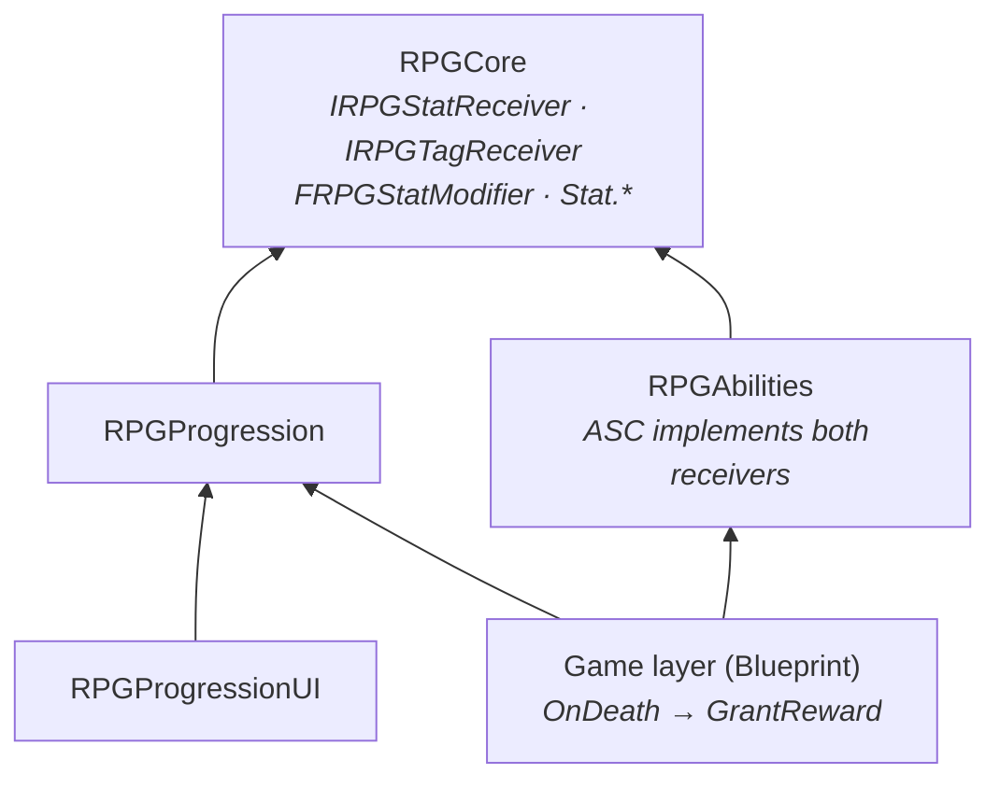
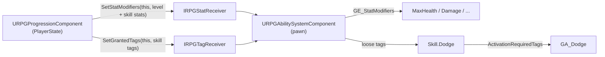

# Progression System

Experience, levels and a skill tree. Killing enemies grants XP, levels give skill points and stat growth, and skills
add stats or unlock abilities through tags. Progression lives on the **PlayerState**, so it survives death and
respawn, and it reaches the character's stats only through RPGCore interfaces: the plugin does not depend on GAS.

| Question | Owner |
|---|---|
| *What level is the player, how much XP, how many points?* | **`URPGProgressionComponent`** (on the PlayerState) |
| *What does a skill do and what does it need?* | **`URPGSkillDefinition`** (data asset) |
| *Which skills form a tree and where are they drawn?* | **`URPGSkillTreeDefinition`** (data asset) |
| *How much XP is an enemy worth?* | **`URPGExperienceRewardComponent`** (on the enemy) |
| *How do levels and skills change stats and abilities?* | **`IRPGStatReceiver`** / **`IRPGTagReceiver`** (RPGCore), implemented by the ASC |
| *How does the player see it?* | XP bar, skill node and skill tree widgets (`RPGProgressionUI`) |

---

## 1. Modules

```
Plugins/
├── RPGCore/                               IRPGStatReceiver, IRPGTagReceiver, FRPGStatModifier, Stat.* tags
└── RPGProgression/
    ├── RPGProgression   (Runtime)         Progression component, skill / tree definitions, XP reward component
    └── RPGProgressionUI (Runtime)         XP bar, skill node, skill tree screen (UMG)
```

| Module | Depends on | Why |
|---|---|---|
| `RPGProgression` | `RPGCore`, `GameplayTags` | Sends stat modifiers and tags through RPGCore interfaces |
| `RPGProgressionUI` | `RPGProgression`, `RPGCore`, `UMG` (+ private `Slate`, `SlateCore`, `InputCore`) | Displays progression; the tree draws its lines with Slate |

**`RPGProgression` does not depend on `RPGAbilities`.** It does not know about attribute sets, gameplay effects or
the health component. A project without GAS can implement `IRPGStatReceiver` / `IRPGTagReceiver` on its own
component and reuse the whole system.



---

## 2. `URPGProgressionComponent`

### Where it lives

On the **PlayerState** (`BP_PlayerState`, set as *Player State Class* in the GameMode).

| Option | Problem |
|---|---|
| On the pawn | Level and skills would be lost on death / respawn |
| On the PlayerController | Not reachable from other players' pawns or from the pawn's own perspective (`GetPlayerState`) |
| **On the PlayerState** | Survives respawn, reachable from pawn and controller, the place Save / Load and multiplayer expect |

The component sends its bonuses to the **current pawn** (`GetTargetActor`). It listens to `APlayerState::OnPawnSet`
and pushes everything again whenever a new pawn is possessed, so a respawned character gets its level and skill
bonuses back immediately.

### Settings

| Property | Description |
|---|---|
| `ExperienceCurve` | `UCurveFloat`: x = level, y = XP needed to reach the next level (`C_ExperiencePerLevel`) |
| `StartingLevel`, `MaxLevel` | Level range |
| `SkillPointsPerLevel` | Points granted for every level gained |
| `StatsPerLevel` | Stat growth per level (e.g. `Stat.MaxHealth +10`) as `FRPGStatModifier`s |
| `SkillTree` | The `URPGSkillTreeDefinition` shown by the tree screen |

### State

`Level`, `Experience`, `SkillPoints` and `UnlockedSkills` are marked `SaveGame`, ready for the Save / Load system.

### Events

| Event | When |
|---|---|
| `OnExperienceChanged` | XP changed (current XP and XP needed for the next level) |
| `OnLevelUp(NewLevel, LevelsGained)` | Once per `AddExperience` call, even when several levels are gained at once |
| `OnSkillPointsChanged(SkillPoints)` | Points gained on level up or spent on a skill |
| `OnSkillUnlocked(Skill)` | A skill was unlocked |

### Functions

| Function | Description |
|---|---|
| `AddExperience(Amount)` | Adds XP and processes any number of level ups |
| `GetLevel`, `GetExperience`, `GetExperienceToNextLevel`, `GetExperienceNormalized`, `IsMaxLevel` | Queries (the XP bar uses them) |
| `GetSkillPoints` | Unspent points |
| `CanUnlockSkill(Skill)` | Returns an `ERPGSkillUnlockResult` without changing anything (the tree uses it for node colours) |
| `UnlockSkill(Skill)` | Same checks, then spends the points and applies the skill |
| `IsSkillUnlocked(Skill)` | Query |
| `GetSkillTree()` | The configured tree |
| `GetTargetActor()` | The pawn that receives the bonuses (the PlayerState's pawn, otherwise the owner) |
| `FindProgressionComponent(Actor)` *(static)* | Finds the component from any actor: on the actor itself, on its PlayerState (pawn or controller), or on its instigator's PlayerState (projectiles, traps) |

---

## 3. Experience and levels

```
AddExperience(Amount)
  Experience += Amount
  while Experience >= XP needed for the next level and not max level:
      Experience -= needed
      Level++, LevelsGained++
      SkillPoints += SkillPointsPerLevel
  (the loop stops at MaxLevel)
  push stats to the pawn            (state first...)
  broadcast OnExperienceChanged     (...then events)
  if LevelsGained > 0: broadcast OnLevelUp, OnSkillPointsChanged
```

- A big reward can give **several levels at once**; `OnLevelUp` fires once with `LevelsGained`, so the UI plays one
  animation instead of three.
- The loop uses `break`, not `return`, when it reaches the max level. A `return` inside the loop skipped the stat push
  and every broadcast (this was a real bug during development).
- `GetExperienceNormalized` casts to `float` before dividing; integer division always returned 0.

---

## 4. Skills

### `URPGSkillDefinition` (Primary Data Asset)

| Property | Description |
|---|---|
| `DisplayName`, `Description`, `Icon` (soft) | UI |
| `SkillPointCost`, `RequiredLevel` | Requirements |
| `Prerequisites` | Other skills that must be unlocked first |
| `StatModifiers` | `FRPGStatModifier`s (e.g. `Stat.MaxHealth +25`) |
| `GrantedTags` | Tags under `Skill.*` (e.g. `Skill.Dodge`) |

### Unlock rules

`CanUnlockSkill` and `UnlockSkill` share one check, in this order:

| `ERPGSkillUnlockResult` | Meaning |
|---|---|
| `InvalidSkill` | `nullptr` |
| `AlreadyUnlocked` | |
| `LevelTooLow` | `Level < RequiredLevel` |
| `MissingPrerequisite` | A prerequisite is not unlocked |
| `NotEnoughPoints` | `SkillPoints < SkillPointCost` |
| `Success` | `UnlockSkill` spends the points, stores the skill, pushes stats and tags, then broadcasts |

### Example skills

| Asset | Requirement | Effect |
|---|---|---|
| `DA_Skill_Toughness` | Level 2 | `Stat.MaxHealth +25` |
| `DA_Skill_Strength` | Toughness | `Stat.Damage +3` |
| `DA_Skill_Endurance` | Level 3, cost 2 | `Stat.MaxStamina +20` |
| `DA_Skill_Dodge` | Level 2 | Grants `Skill.Dodge`, which `GA_Dodge` requires |

### `URPGSkillTreeDefinition` (Primary Data Asset)

A list of `FRPGSkillTreeNode { Skill, Position }`. The tree is **data**: prerequisites come from the skills,
positions from the tree, so the same skill can appear in two trees at different places. `DA_SkillTree_Default` holds
the four example skills.

---

## 5. Bridges to the character



| Bridge | How it works |
|---|---|
| **Stats** | Level growth (`StatsPerLevel`, scaled by the current level) and every unlocked skill's `StatModifiers` are summed into one **snapshot** and sent with `SetStatModifiers(this, ...)`. The ASC replaces the effect it holds for this source; equipment keeps its own effect because its source is different |
| **Tags** | All unlocked skills' `GrantedTags` are sent as one snapshot with `SetGrantedTags(this, ...)`. The ASC removes the loose tags it previously added for this source and adds the new set. Loose tags are reference-counted, so two sources granting the same tag do not remove each other's |
| **Ability gating** | `GA_Dodge` has `Activation Required Tags = Skill.Dodge`. Before the skill is unlocked, GAS simply refuses to activate it; no code checks skills |

The same snapshot pattern is used by equipment (section 5 of [Abilities.md](Abilities.md)): a missed event can never
leave stats wrong, because every push replaces the previous one.

---

## 6. XP rewards

### `URPGExperienceRewardComponent`

| Member | Description |
|---|---|
| `ExperienceReward` | XP this actor is worth (per Blueprint or per instance) |
| `GrantReward(Receiver)` | Finds the receiver's progression with `FindProgressionComponent` and calls `AddExperience`. Returns `true` if granted |
| `HasGrantedReward()` | The reward is given **at most once** |

If the receiver has no progression (an AI kill, environmental death), nothing happens and the reward is still
available. AI controllers have no PlayerState by default, so enemies never earn XP from each other.

### Wiring (game layer)

`RPGProgression` cannot see `URPGHealthComponent` (that is `RPGAbilities`), so the enemy Blueprint connects the two:

```
On Death (RPGHealth)  ── Killer ──►  RPGExperienceReward → Grant Reward (Receiver)
```

`Killer` is the instigator of the damage effect (the attacking pawn). `FindProgressionComponent` walks from that pawn
to its PlayerState.

---

## 7. UI (`RPGProgressionUI`)

### `URPGExperienceBarWidget`

| Member | Description |
|---|---|
| `ExperienceBar` (required) | `ProgressBar` |
| `LevelText`, `ExperienceText` (optional) | `"Lv 3"`, `"40 / 150"` or `"MAX"` |
| `SetProgression(Component)` | Bind manually; `nullptr` empties the bar |
| `BP_OnLevelUp` | Designer hook (flash, sound) |

Binds itself on construct to the owning player's PlayerState component.

### `URPGSkillNodeWidget`

One skill: icon, optional name, a text tooltip (name, description, cost, required level) and three states.

| State | When | Example look (`BP_OnStateChanged`) |
|---|---|---|
| `Locked` | Requirements not met | Grey, faded icon |
| `Available` | `CanUnlockSkill == Success` | Gold frame |
| `Unlocked` | Already unlocked | Green frame |

The node only **displays and reports**: `OnClicked(Node)` on left click. It never unlocks anything itself; the tree
decides. `IconImage` and `NameText` are `BlueprintReadOnly` so the state colours can be set in the graph.

### `URPGSkillTreeWidget`

| Member | Description |
|---|---|
| `NodeCanvas` (required) | `CanvasPanel`; nodes are placed at each tree node's `Position` (top-left corner) |
| `SkillPointsText` (optional) | `"Skill Points: 2"` |
| `NodeClass` | `WBP_SkillNode` |
| `ActiveLineColor`, `InactiveLineColor`, `LineThickness` | Prerequisite lines |
| `BP_OnUnlockFailed(Node, Result)` | Feedback (`NotEnoughPoints`, `LevelTooLow`, ...) |
| `BP_OnSkillUnlocked(Node)` | Feedback for any unlock |

- **Click → `UnlockSkill`.** On success the tree does **not** refresh itself; it refreshes when the component
  broadcasts `OnSkillUnlocked` / `OnSkillPointsChanged` / `OnLevelUp`. Skills unlocked from anywhere else (a quest,
  a debug key) update the screen the same way.
- **Lines** are drawn in `NativePaint` from each prerequisite to the skill. `NativePaint` runs after the children
  are painted, so the lines start and end at the node **edges** (a ray / rectangle intersection) instead of the
  centres and never cover an icon. Node rectangles come from their cached geometry, converted to the tree's local
  space, so DPI scaling and canvas offsets do not matter.
- **Modal clicks:** the tree returns `Handled` for any mouse button, so clicking empty space never reaches the game
  (e.g. triggering an attack).
- The widget is built on construct and cleared on destruct (`SetProgression(nullptr)`), so reusing one instance for
  every open is safe and always shows fresh data.

---

## 8. Setup

### Player
1. Create **`BP_PlayerState`** (parent `PlayerState`), add **`RPG Progression`**, and set it as *Player State Class*
   in the GameMode.
2. Component settings: `ExperienceCurve` = `C_ExperiencePerLevel`, `StartingLevel`, `MaxLevel`,
   `SkillPointsPerLevel`, `StatsPerLevel`, `SkillTree` = `DA_SkillTree_Default`.
3. The pawn needs a component implementing `IRPGStatReceiver` / `IRPGTagReceiver` (the RPG Ability System
   component). `GE_StatModifiers` must have a SetByCaller modifier for every stat tag a level or skill uses
   (`Stat.MaxHealth`, `Stat.MaxStamina`, `Stat.Damage`, `Stat.Armor`).

> The SetByCaller *Data Tag* picker only lists `SetByCaller.*` tags. Paste `(TagName="Stat.MaxHealth")` into the
> field to use a `Stat.*` tag.

### Skills
1. Add the `Skill.*` tags in *Project Settings → Gameplay Tags* (e.g. `Skill.Dodge`).
2. Create `DA_Skill_*` assets (`RPGSkillDefinition`) and one `DA_SkillTree_*` (`RPGSkillTreeDefinition`) with
   positions.
3. Abilities that need a skill: *Activation Required Tags* = the skill's tag.

### Enemies
Add **`RPG Experience Reward`**, set `ExperienceReward`, and bind *On Death* of `RPG Health` to *Grant Reward* with
`Killer` as the receiver.

### UI
| Widget Blueprint | Parent | Required children |
|---|---|---|
| `WBP_ExperienceBar` | `RPGExperienceBarWidget` | `ProgressBar` **ExperienceBar** |
| `WBP_SkillNode` | `RPGSkillNodeWidget` | `Image` **IconImage**; a `Visible` border to catch clicks |
| `WBP_SkillTree` | `RPGSkillTreeWidget` | `CanvasPanel` **NodeCanvas**; a `Visible` background image |

### Opening the tree (`BP_PlayerController`)
`IA_SkillTree` (K, trigger *Pressed*) → `ToggleSkillTree`:

| | Open | Close |
|---|---|---|
| Widget | Create once, `Add to Viewport` | `Remove from Parent` |
| Input mode | `Game And UI` (no focus widget, *Do Not Lock*) | `Game Only` (*Flush Input*) |
| Cursor | Shown | Hidden |
| Look input | `Set Ignore Look Input` | `Reset Ignore Look Input` (it is reference-counted) |

`Game And UI` keeps game input alive, so the same key closes the screen.

---

## 9. Tags

| Tag | Defined in | Use |
|---|---|---|
| `Stat.MaxHealth`, `Stat.MaxStamina`, `Stat.Damage`, `Stat.Armor` | RPGCore | Level and skill stat modifiers |
| `Skill.*` (e.g. `Skill.Dodge`) | Project settings | Granted by skills; required by abilities |

---

## 10. Design Decisions

| Decision | Reason |
|---|---|
| Component on the PlayerState | Survives respawn; the natural place for Save / Load and multiplayer |
| Push to the pawn on every `OnPawnSet` | A new pawn starts from base stats; progression re-applies itself without the pawn knowing about it |
| RPGCore interfaces instead of GAS | Progression and Abilities stay independent plugins; GAS is one possible receiver |
| Snapshots keyed by source | Level, skills and equipment never overwrite each other; a missed event cannot leave stats wrong |
| Skills unlock abilities through tags | Abilities stay granted all the time; `ActivationRequiredTags` does the gating, no skill checks in ability code |
| One check for `CanUnlockSkill` and `UnlockSkill` | The UI colour and the actual result can never disagree |
| Typed `ERPGSkillUnlockResult` | The UI can show *why* an unlock failed |
| Tree layout in a separate asset | Skills are reusable; trees are just placement |
| Reward as a component + one Blueprint wire | XP per enemy is data; the plugin does not depend on the health component |
| Node widget only reports clicks | Same pattern as inventory and equipment slots: the owner decides |

---

## 11. Pitfalls found during development

| Symptom | Cause | Fix |
|---|---|---|
| `Killer` was always null in `OnDeath` | With a meta attribute, `Health` is changed by `SetHealth` in `PostGameplayEffectExecute`, not by the effect, so its change callback has no `GEModData` | `URPGHealthSet` exposes `GetDamageInstigator()` only for the duration of that `SetHealth` (see [Abilities.md](Abilities.md)) |
| No level-up events at max level | `return` inside the level loop | `break` |
| XP bar always empty | Integer division in `GetExperienceNormalized` | Cast to `float` first |
| `IconImage` not visible in the Blueprint graph | `BindWidget` property without `BlueprintReadOnly` | Add `BlueprintReadOnly` |
| Clicking empty space in the tree attacked | Unhandled clicks reach the game in `Game And UI` mode | The tree returns `Handled` for every click |
| First K press did nothing | `Create Widget → Set` was not connected to the open / close branch | Both `Is Valid` paths lead to the same branch |

---

## 12. Known Limitations / Next Steps

- `BeginPlay` initialises `Level` from `StartingLevel`; the Save / Load system must restore state **after** that.
- No respec / refund of skill points.
- Levelling up does not heal; the game layer can bind `OnLevelUp` if it wants that.
- XP only comes from kills; quests and discoveries can call `AddExperience` directly.
- Single-player only: state is not replicated.
- The tree screen has no pan / zoom and no gamepad navigation; node positions are absolute canvas coordinates.
- Node tooltips are plain text; a rich tooltip widget (like the item tooltip) is a possible improvement.
