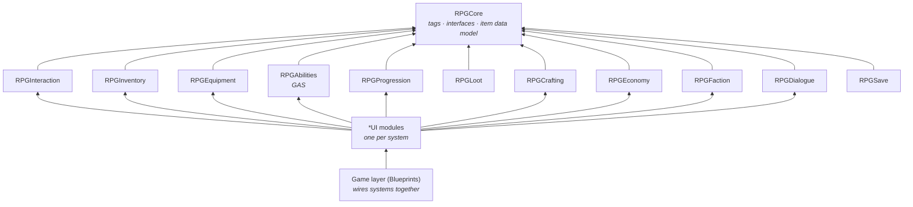

# RPG Template (Unreal Engine 5)

A modular, data-driven RPG framework for Unreal Engine 5.7, written in C++ with Blueprint-friendly extension points,
and a playable **test room** that shows every system working together.

Each gameplay system is its own plugin. Systems talk to each other only through a small shared core (Gameplay Tags,
interfaces and delegates), so any of them can be removed, replaced or reused in another project, and designers build
content (items, recipes, dialogues, loot tables, UI) in the editor without touching C++.


---

## Contents

- [Systems](#systems)
- [The test room](#the-test-room)
- [Getting started](#getting-started)
- [Architecture](#architecture)
- [System overviews](#system-overviews)
- [Project layout](#project-layout)
- [Credits](#credits)

---

## Systems

| System | Plugin | What it does |
|---|---|---|
| Core | `RPGCore` | Gameplay tags, cross-system interfaces, the item data model (definition + fragments), rarity, stat modifiers |
| Interaction | `RPGInteraction` (+UI) | Focus detection (trace or overlap), press or hold to interact, outline highlight, world-anchored prompt |
| Inventory | `RPGInventory` (+UI) | Stacking, slot and weight limits, world pickups, dropping, grid UI with tabs and tooltips |
| Equipment | `RPGEquipment` (+UI) | Tag-based slots, safe swaps with rollback, attached meshes, stat modifiers, equipment panel |
| Abilities & Stats | `RPGAbilities` (+UI) | Gameplay Ability System: health, stamina, combat attributes, damage pipeline, melee combo and dodge |
| Progression | `RPGProgression` (+UI) | XP and levels from a curve, stat growth, skill tree with prerequisites and skill-gated abilities |
| Loot & Rarity | `RPGLoot` | Weighted, nestable loot tables, seeded rolls, drop-rate simulation, enemy and chest drops |
| Crafting | `RPGCrafting` (+UI) | Data recipes, all-or-nothing transactions, stations, timed crafting, recipe scrolls |
| Economy | `RPGEconomy` (+UI) | Wallets and currencies, merchants with stock and price multipliers, a trade screen |
| Faction & Reputation | `RPGFaction` (+UI) | Factions with ranks, reputation that spreads to allies and rivals, hostility for AI |
| Dialogue | `RPGDialogue` (+UI) | Branching dialogue assets with conditions and actions, speakers, portraits, a dialogue screen |
| Save / Load | `RPGSave` | Save slots with metadata, per-actor world state, quick save and autosave hooks |

Around ~17,000 lines of C++ in 12 plugins (21 modules). The game layer (hero, enemies, NPCs, stations, menus) is in
Blueprints under `Content/Showcase`.

---

## The test room

`L_Showcase` is a small stone hall built to try every system in a few minutes. Start the game from the main menu
(`L_MainMenu`, the default map) or open `L_Showcase` in the editor and press Play.

| Where | What to try |
|---|---|
| Entrance | Save shrine (save and load), quick save `F5`, quick load `F9` |
| Elder's table | Dialogue with conditions and actions, the bandit quest, reputation with the village |
| Smithy corner | Blacksmith (trade, gift sword after accepting the quest), forge and workbench (crafting), ore and wood pickups |
| Middle of the hall | Training dummies: combo attacks, dodge, damage numbers |
| North hall (door) | Bandit arena: AI with perception and group alert, loot drops, XP; the leader carries the seal for the quest |

### Controls

| Action | Keyboard / mouse | Gamepad |
|---|---|---|
| Move / look | `W` `A` `S` `D` / mouse | Left / right stick |
| Attack (combo) | Left mouse button | Face button right |
| Dodge | `Space` | Face button bottom |
| Walk | Hold `Left Alt` | |
| Interact | `E` | |
| Inventory | `I` or `Tab` | |
| Crafting | `C` | |
| Skill tree | `K` | |
| Reputation | `J` | |
| Quick save / load | `F5` / `F9` | |
| Dialogue answers | `1`-`9`, `Space` to continue, `Esc` to leave | |

---

## Getting started

### Requirements

- Unreal Engine **5.7**
- Visual Studio 2022 (C++ game development workload) or JetBrains Rider
- [Git LFS](https://git-lfs.com/): every `.uasset` / `.umap` is stored in LFS

### Third-party content you need to add

The C++ plugins and the Blueprint game layer are in this repository. Some art comes from Fab packs whose license
does not allow redistributing their files, so they are not in the repository. Get them from
[Fab](https://www.fab.com/) and add them to the project; each one must end up in the folder below, which is where
the showcase assets look for it.

| Pack | Folder | Used for |
|---|---|---|
| Dark Knight (character) | `Content/Dark_Knight/` | The hero's mesh and animations |
| Assassin (character) | `Content/Assassin/` | Bandit and bandit leader meshes and animations |
| Medieval Village (Marco Maria Rossi) | `Content/MedievalVillage/` | Walls, floors and props of the test room and stations |
| Dynamic Falling (animations) | `Content/DynamicFalling/` | The hero's dodge roll |

Without them the code compiles and the systems work, but the characters and the room show missing meshes.

### Build and run

```bash
git lfs install
git clone https://github.com/eren-pekdemir/RPGTemplate.git
```

1. Add the Fab packs above.
2. Right-click `RPGTemplate.uproject` → **Generate Visual Studio project files**.
3. Open the solution, build **RPGTemplateEditor** (Development Editor, Win64), and start it; or simply double-click
   the `.uproject` and let the editor build the modules.
4. Press Play: the main menu opens; **New Game** loads the test room.

---

## Architecture



Rules the code base follows:

- **System plugins depend only on `RPGCore`** (and engine modules), never on each other. The compiler enforces it:
  a system cannot include another system's headers because that module is not in its `Build.cs`.
- **Cross-system communication goes through interfaces** in `RPGCore` (`IRPGInteractable`, `IRPGItemContainer`,
  `IRPGWorldItem`, `IRPGStatReceiver`, `IRPGTagReceiver`, `IRPGSaveable`, ...), delegates and Gameplay Tags.
  Equipment never sees the inventory; it sees "an item container".
- **Runtime and UI are separate modules.** Gameplay modules never depend on UMG, so a dedicated server or a game with
  its own UI can drop the UI modules.
- **Data over code.** Designer-facing values are properties, data assets or Gameplay Tags.
- **No needless ticking.** Components are event- or timer-driven; tick is enabled only while it is needed
  (a hold interaction, a craft in progress, a typing dialogue line).

---

## System overviews

Detailed documentation for the first systems is in [`docs/systems/`](docs/systems): each covers the features,
the classes and a step-by-step setup.

- **Interaction** ([docs](docs/systems/Interaction.md)): two focus strategies (camera trace for first person, scored
  overlap with line of sight and hysteresis for third person), instant or hold interactions with a progress bar,
  single-use objects, stencil outline styles, a prompt that follows the object and survives respawns.
- **Inventory** ([docs](docs/systems/Inventory.md)): per-item stack sizes and partial adds, slot and optional weight
  limits, pickups that keep their remainder, drops that can never lose items, a grid UI with category tabs.
- **Equipment** ([docs](docs/systems/Equipment.md)): slots are tags, swaps roll back when the container is full,
  static meshes go to sockets and skeletal meshes follow the body, stat modifiers flow to the ability system.
- **Abilities & Stats** ([docs](docs/systems/Abilities.md)): attribute sets for health, stamina and combat, one damage
  effect with an execution for every weapon and target, input-tag routing, melee combo and dodge with cost and cooldown.
- **Progression** ([docs](docs/systems/Progression.md)): lives on the PlayerState so it survives death, levels and
  skills push stats and tags through the same interfaces as equipment, kill rewards on enemies.
- **Loot & Rarity** ([docs](docs/systems/Loot.md)): project-wide rarity colours, weighted and nested tables,
  `rpg.Loot.Simulate <Table>` rolls a table thousands of times and logs the real drop rates.
- **Crafting** ([docs](docs/systems/Crafting.md)): take ingredients, give outputs, exact rollback on failure;
  stations with hierarchical tags, timed batches, recipe scrolls, skill-gated recipes.
- **Economy**: wallets hold any number of currencies (tags); merchants have stock and buy / sell price multipliers
  on top of item values scaled by rarity; the trade screen opens from a dialogue action.
- **Faction & Reputation**: faction data assets with rank thresholds, reputation changes that spread to related
  factions, and hostility queries the bandit AI uses to pick targets.
- **Dialogue**: dialogue assets of nodes and answers; conditions (flags, items, reputation) decide what is shown,
  actions (give items, change reputation, set flags, open trade, custom Blueprint actions) run on choice.
  Speakers provide the name and portrait, and the conversation ends when the player walks away.
- **Save / Load**: a game instance subsystem writes slots with a timestamp and map name; actors opt in with a
  saveable component, and their `SaveGame` properties and component states (inventory, equipment, progression,
  reputation, flags, opened chests, killed enemies) come back on load.

---

## Project layout

```
Plugins/RPG*/            The 12 system plugins (runtime module + UI module each)
Source/RPGTemplate/      Empty game module (the game layer is Blueprint)
Content/Showcase/        Game layer: hero, bandits, NPCs, items, recipes, dialogues, UI, maps
  Maps/L_MainMenu        Default map: main menu
  Maps/L_Showcase        The test room
Content/Widgets/         Generic UI widgets used by the system plugins' sample screens
Config/                  Project settings, gameplay tags, collision channels, input
docs/systems/            Per-system documentation
docs/dev-notes/          Development notes and code reviews (Turkish)
```

---

## Credits

Third-party assets and their licenses are listed in [`CREDITS.md`](CREDITS.md).

## Author

**Eren Pekdemir**, Computer Engineering student, Burdur Mehmet Akif Ersoy University
