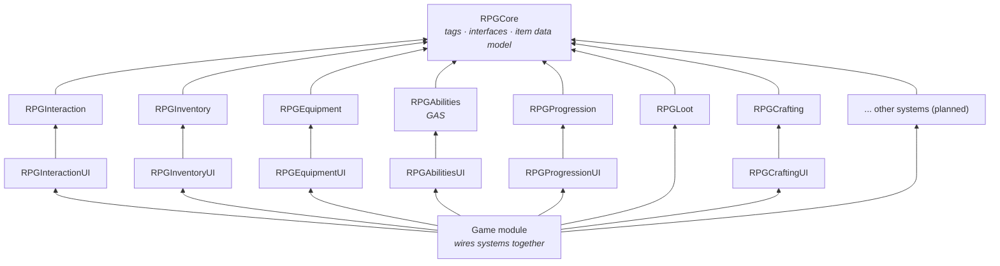
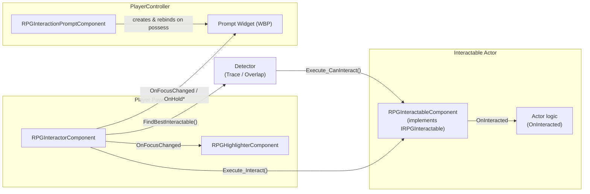

# RPG Template (Unreal Engine 5)

A modular, data-driven RPG framework for Unreal Engine 5, written in C++ with Blueprint-friendly extension points.

Every gameplay system lives in its own plugin and talks to the others only through a small shared core
(Gameplay Tags, interfaces and delegates). Systems can be enabled, disabled or replaced independently,
and designers build content (interactables, items, styles, UI) in the editor without touching C++.

> **Status:** Work in progress. Core, Interaction, Inventory, Equipment, Abilities & Stats, Progression, Loot & Rarity and Crafting are complete; the remaining systems are planned below.

---

## Systems

| System | Plugin | Status |
|---|---|---|
| Core (tags, interfaces, item data model, item quantity, rarity settings, stat modifiers, stat & tag receivers) | `RPGCore` | ✅ |
| **Interaction** (focus, hold-to-interact, highlight, prompt UI) | `RPGInteraction` | ✅ |
| **Inventory** (stacking, weight, pickups, drop, grid UI with tabs & tooltips) | `RPGInventory` | ✅ |
| **Equipment** (tag-based slots, safe swaps, attached meshes, stat modifiers, equipment panel) | `RPGEquipment` | ✅ |
| **Abilities & Stats** (GAS: health / stamina / combat attributes, damage pipeline, melee & dodge, HUD bars) | `RPGAbilities` | ✅ |
| **Progression** (XP & levels, stat growth, skill tree with prerequisites, skill-gated abilities, kill rewards, tree UI) | `RPGProgression` | ✅ |
| **Loot & Rarity** (project-wide rarity, weighted & nested loot tables, drop-rate simulation, drops & chests, rarity visuals) | `RPGLoot` | ✅ |
| **Crafting** (data recipes, all-or-nothing transactions, stations, skill-gated recipes, timed crafting, recipe scrolls, crafting screen) | `RPGCrafting` | ✅ |
| Market / Economy | `RPGEconomy` | ⏳ |
| Faction & Reputation | `RPGFaction` | ⏳ |
| Dialogue (+ graph editor) | `RPGDialogue` | ⏳ |
| Save / Load | `RPGSave` | ⏳ |

---

## Architecture



**Rules the codebase follows**

- **System plugins depend only on `RPGCore`** (and engine modules), never on each other.
  The rule is enforced by the compiler: a system cannot `#include` another system because it is not in its `Build.cs`.
- **Cross-system communication** goes through interfaces (`IRPGInteractable`, `IRPGItemContainer`, `IRPGWorldItem`, `IRPGStatReceiver`, `IRPGTagReceiver`, ...),
  delegates and Gameplay Tags defined in `RPGCore`.
- **Runtime logic and UI are separate modules.** Core gameplay modules never depend on UMG, so a dedicated
  server or a game with its own UI can drop the UI module.
- **Data over code.** Designer-facing values are properties, Data Assets or Gameplay Tags; collision channels,
  styles and widget classes are chosen in the editor, never hard-coded.
- **No needless ticking.** Components are event-driven or timer-driven; tick is enabled only while it is needed.

---

## Interaction System

A complete, extensible interaction framework: the player focuses on an object, the object is highlighted,
a world-anchored prompt appears, and interacting can be instant or hold-to-interact with a progress bar.

📖 **Full documentation:** [`Interaction.md`](Interaction.md)

### Features

- **Two focus strategies, switchable from a dropdown:**
  - *Trace Detector* — camera-centered sphere sweep (first-person / aim-based games)
  - *Overlap Detector* — scores nearby objects by distance and facing angle, with line-of-sight check and
    focus hysteresis (third-person action RPGs)
- **Instant or hold-to-interact** with progress, cancel on release / focus loss / object disabled or destroyed
- **Single-use and toggleable** interactables
- **Stencil-based outline highlight** with per-object styles (`Default`, `Quest`, `Danger`, or none) and per-mesh selection via component tags
- **World-anchored prompt UI** that follows the object, survives pawn respawn / possession changes, and is fully re-skinnable in UMG
- **Debug visualization** via the `rpg.Interaction.Debug 1` console variable
- Works with **Blueprint-only** interactables (interface implemented in Blueprint) as well as the provided component

### How it fits together



Nobody knows the concrete type of anybody else: the Interactor only knows the `IRPGInteractable` contract,
the Interactable only broadcasts `OnInteracted`, and the highlighter and prompt only listen to the Interactor's delegates.

### Quick start: make a character able to interact

1. **Pawn** → add **`RPG Interactor`** component
   - *Detector:* `Trace Detector` (first-person) or `Overlap Detector` (third-person)
   - Set the detector's channel (`Trace Channel` / `Overlap Channel`) to **`Interaction`**
2. **Input** → create `IA_Interact` (bool) and map it (e.g. `E`). In the pawn:
   - `Started` → `Start Interaction`
   - `Completed` → `Stop Interaction`
3. *(Optional)* **Highlight** → add **`RPG Highlighter`** to the pawn, enable
   *Project Settings → Rendering → Custom Depth-Stencil Pass = Enabled with Stencil*,
   and add `MI_InteractionOutline` to an unbound Post Process Volume.
4. *(Optional)* **Prompt UI** → add **`RPG Interaction Prompt`** to your **PlayerController** and set
   *Prompt Widget Class* to `WBP_InteractionPrompt` (or your own widget derived from `RPGInteractionPromptWidget`).

### Quick start: make an object interactable

1. Give its mesh the **`Interactable`** collision preset.
2. Add **`RPG Interactable`** component and set *Interaction Prompt*, *Hold Duration*, *Single Use*, *Highlight Style*.
3. In the Event Graph, bind **`On Interacted`** and write what should happen.

No C++ required. Custom behaviour (e.g. a prompt that changes between "Open" / "Close") can implement the
`RPGInteractable` interface directly on the actor instead.

---

## Inventory System

A slot- and weight-limited inventory with stacking, world pickups, dropping, and a Witcher-style grid UI.
The logic is list-based; the grid exists only in the UI.

📖 **Full documentation:** [`Inventory.md`](Inventory.md)

### Features

- **Stacking** with per-item `MaxStackSize`, partial adds ("10 of 12 arrows fit")
- **Slot limit + optional weight limit** (one checkbox to turn weight off, optional overweight mode)
- **Data-driven items:** `RPGItemDefinition` data assets + an inventory fragment (weight, world mesh, droppable)
- **World pickups** that show a live prompt (`Pick up Arrow x12` / `Inventory Full`) and keep the remainder
- **Dropping** that can never lose items (spawn first, then remove)
- **Grid UI:** reusable slots, stack counts, hover highlight, tooltips, weight bar,
  **right-click drop / Shift = whole stack**, and **category tabs** driven by hierarchical Gameplay Tags
- **No coupling to Interaction:** the pickup implements the RPGCore interface; the game layer wires
  "hide prompts while the menu is open"

### Quick start

1. **Pawn** → add **`RPG Inventory`** (slots, weight, starting items, `Pickup Class`).
2. **Item** → Data Asset of `RPGItemDefinition` + **`RPG Inventory Fragment`** (weight, world mesh).
3. **World** → `BP_ItemPickup` (from `RPGItemPickup`) with the `Interactable` collision preset; set `Item` / `Quantity`.
4. **UI** → Widget Blueprints from the four `RPGInventoryUI` bases, then **`RPG Inventory UI`** on the
   PlayerController and an input action → `Toggle Inventory`.

---

## Equipment System

Tag-based equipment slots that move items to and from any item container without ever losing or duplicating them,
attach meshes to the character, and add stat modifiers. Equipment does not depend on the inventory plugin.

📖 **Full documentation:** [`Equipment.md`](Equipment.md)

### Features

- **Gameplay Tag slots** (`Equipment.Slot.Head`, `MainHand`, ...): new slots are data, and each character chooses
  its own slot set
- **Equipment fragment** on the item definition: slot, static or skeletal mesh, socket, stat modifiers
- **Safe transfer** through `IRPGItemContainer`: swaps work even with a full inventory, with rollback and a typed
  `ERPGEquipResult` (`ContainerFull`, `NoValidSlot`, ...)
- **Visuals component:** static meshes attach to sockets, skeletal meshes follow the body via Leader Pose;
  no collision, so they never block interaction traces
- **Stat modifiers** (`Stat.Damage`, `Stat.Armor`, ...) pushed as a snapshot to any `IRPGStatReceiver`
  (the GAS ability system component applies them as an effect)
- **Equipment panel:** freely laid-out slots, live stats, double-click to unequip,
  **double-click in the inventory to equip**
- **Shared tooltip** through the RPGCore `IRPGItemTooltip` interface, so the two UI modules never depend on each other

### Quick start

1. **Pawn** → add **`RPG Equipment`** (available slots, starting equipment) and **`RPG Equipment Visuals`**.
2. **Item** → add an **Equipment** fragment to an `RPGItemDefinition` (slot, mesh, socket, modifiers).
3. **Skeleton** → add the sockets your items use (e.g. `weapon_r`).
4. **UI** → `WBP_EquipmentSlot` / `WBP_EquipmentPanel` from the `RPGEquipmentUI` bases, set each slot's
   `Slot Tag`, place the panel in the inventory screen and wire `On Entry Activated → Equip From Container`.

---

## Abilities & Stats System (GAS)

Health, stamina and combat stats on Unreal's Gameplay Ability System, with a damage pipeline, equipment bonuses,
input-driven abilities with cost and cooldown, death handling and generic HUD bars.

📖 **Full documentation:** [`Abilities.md`](Abilities.md)

### Features

- **Attribute sets:** Health / MaxHealth, Stamina / MaxStamina, Damage / Armor, with clamping for every kind of
  effect and an `IncomingDamage` meta attribute
- **Data-driven setup:** attribute sets, starting values, passive effects and abilities are chosen on the component;
  starting values come from a gameplay effect, not from code
- **Damage pipeline:** one `GE_Damage` with an execution, `attacker Damage + ability base damage - target Armor`
  (with a minimum), so the same effect works for every weapon and target
- **Equipment bridge:** equipment pushes its modifiers through the RPGCore `IRPGStatReceiver` interface; the ASC
  applies them as one SetByCaller effect per source. Neither plugin depends on the other
- **Abilities:** input-tag routing (keyboard, gamepad or AI), melee attack (montage or delay, sphere sweep, one hit per
  target), dodge with stamina **cost** and **cooldown** as plain effects, regenerating stamina via a periodic effect
- **Health component:** `OnHealthChanged` / `OnDeath` with the instigator; `State.Dead` blocks all abilities
- **Generic attribute bar** widget: pick any value / max pair per instance; follows the possessed pawn

### Quick start

1. **Pawn** → add **`RPG Ability System`** (attribute sets, `GE_InitStats`, `GE_StaminaRegen`, abilities,
   `GE_StatModifiers`) and **`RPG Health`**.
2. **Input** → call `Ability Input Tag Pressed` with `InputTag.Attack` / `InputTag.Dodge`.
3. **HUD** → `WBP_AttributeBar` instances in a HUD widget; choose `Value Attribute` / `Max Attribute`.
4. **Debug** → `showdebug abilitysystem`.

---

## Progression System

Experience, levels and a skill tree on the PlayerState. Enemies grant XP on death, levels give skill points and stat
growth, and skills add stats or unlock abilities. Progression reaches the character only through RPGCore interfaces,
so it does not depend on GAS.

📖 **Full documentation:** [`Progression.md`](Progression.md)

### Features

- **XP and levels** from a curve asset, multi-level gains in one reward, max level, skill points per level and
  per-level stat growth
- **Lives on the PlayerState:** survives death and respawn, and re-applies its bonuses to every new pawn
- **Data-driven skills:** cost, required level, prerequisites, stat modifiers and granted tags in a data asset;
  a typed `ERPGSkillUnlockResult` tells the UI *why* an unlock failed
- **Skill-gated abilities without code:** a skill grants `Skill.Dodge`, and `GA_Dodge` requires it through
  `ActivationRequiredTags`
- **Same snapshot bridge as equipment:** level and skill stats go through `IRPGStatReceiver`, tags through
  `IRPGTagReceiver`; sources never overwrite each other
- **Kill rewards:** an `RPG Experience Reward` component on enemies; one Blueprint wire from `On Death`
- **UI:** XP bar, skill nodes with Locked / Available / Unlocked states and tooltips, and a skill tree screen that
  lays nodes out from data, draws prerequisite lines in `NativePaint` and stays in sync through events

### Quick start

1. **PlayerState** → `BP_PlayerState` with **`RPG Progression`** (curve, level range, points, stat growth, skill tree);
   set it in the GameMode.
2. **Skills** → `RPGSkillDefinition` assets and one `RPGSkillTreeDefinition` with node positions.
3. **Enemies** → **`RPG Experience Reward`**; `On Death` → `Grant Reward (Killer)`.
4. **UI** → `WBP_ExperienceBar` in the HUD; `WBP_SkillNode` / `WBP_SkillTree` and a toggle key on the PlayerController.

---

## Loot & Rarity System

Rarity defined once for the whole project and shown everywhere; weighted, nestable loot tables whose drop rates are
measured with a console command; enemies and chests that drop loot into the world or straight into the inventory.

📖 **Full documentation:** [`Loot.md`](Loot.md)

### Features

- **Project-wide rarity:** `Item.Rarity.*` tags with colour, name and tier in *Project Settings*; coloured slot frames,
  tooltip names, glowing world pickups and pickup notifications all read the same data
- **Loot tables:** weights instead of percentages, "nothing" weight, guaranteed drops, min / max rolls, quantity
  ranges and **nested tables**; per-roll chances shown live in the editor; cycle detection in data validation
- **Deterministic:** every roll uses a seeded `FRandomStream`
- **`rpg.Loot.Simulate`:** rolls a table 10,000+ times and logs per-kill drop rates, average quantities and rarity,
  so balance is measured, not guessed
- **Loot component:** scatter pickups around an enemy (ground-snapped), or give loot directly to a container with
  leftovers dropped, never lost
- **No plugin coupling:** loot spawns pickups through the RPGCore `IRPGWorldItem` interface and fills containers
  through `IRPGItemContainer`
- **"+6 Arrow" notifications** driven by the inventory, so pickups, chests and rewards share one feed

### Quick start

1. **Rarity** → *Project Settings → Game → RPG Rarity*; set `Rarity` on items.
2. **Tables** → `RPGLootTable` assets; verify with `rpg.Loot.Simulate <Table>`.
3. **Enemy** → **`RPG Loot`** component; `On Death` → `Drop Loot`.
4. **Chest** → Interactable + `RPG Loot`; `On Interacted` → `Give Loot To (Instigator)`.

---

## Crafting System

Recipes as data, crafting that can never lose or duplicate items, stations, skill-gated recipes, timed crafting and a
crafting screen. Crafting depends on neither Inventory, Progression nor GAS.

📖 **Full documentation:** [`Crafting.md`](Crafting.md)

### Features

- **Data recipes:** ingredients, several outputs, craft time, category, required station and required tags
- **All-or-nothing transactions:** take ingredients → give outputs → exact rollback on failure; correct even when
  removing ingredients frees the space the outputs need
- **Stations** with hierarchical tags (`Forge.Master` makes every `Forge` recipe); use ends on walking away
- **Skill-gated recipes without coupling:** a Progression skill grants `Skill.Smithing`; crafting reads it through the
  engine's `IGameplayTagAssetInterface`
- **Timed crafting:** batches, progress, cancel with refund; leaving the station cancels station work
- **Recipe scrolls:** a Recipe fragment on any item; reading is wired to the inventory's activation
- **Crafting screen:** recipe list in rarity colours, have / need ingredient lines, missing requirements,
  quantity, progress; opens automatically at a station

### Quick start

1. **Recipes** → `RPGRecipeDefinition` assets.
2. **Pawn** → **`RPG Crafting`**; **PlayerController** → **`RPG Crafting UI`** + a toggle key.
3. **Station** → Interactable + **`RPG Crafting Station`**; `On Interacted` → `Begin Use (Instigator)`.
4. **UI** → `WBP_RecipeEntry` and `WBP_CraftingScreen` from the C++ bases.

---

## Project Setup

- **Engine:** Unreal Engine 5
- **IDE:** JetBrains Rider
- **Source control:** Git + Git LFS (`.uasset`, `.umap`, source art)

```bash
git clone https://github.com/eren-pekdemir/RPGTemplate.git
cd RPGTemplate
git lfs pull
```

Right-click `RPGTemplate.uproject` → *Generate project files*, build the `RPGTemplateEditor` target, and open the project.
The sandbox map `L_Sandbox` contains test interactables for every feature.

---

## Author

**Eren Pekdemir** — Computer Engineering student, Burdur Mehmet Akif Ersoy University
